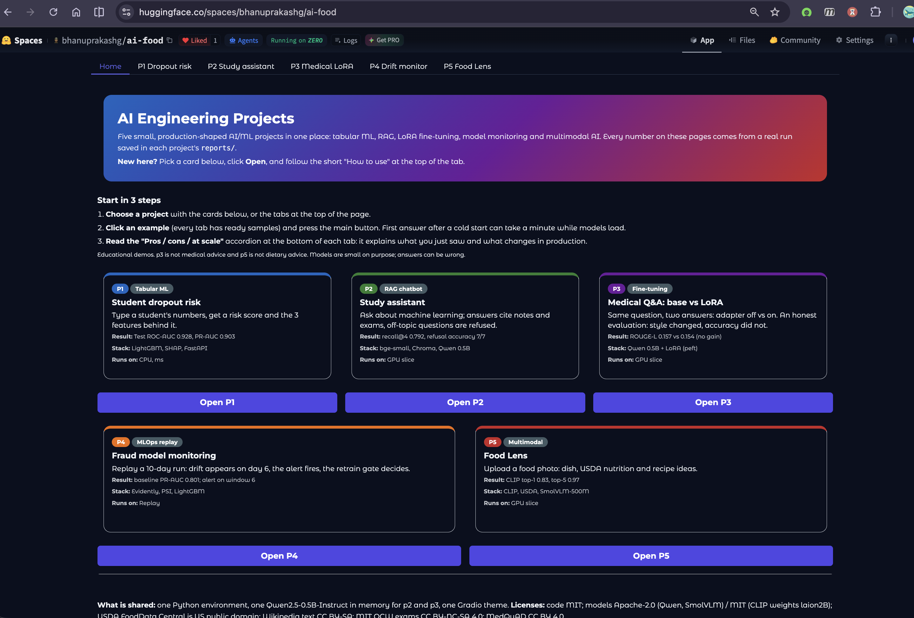
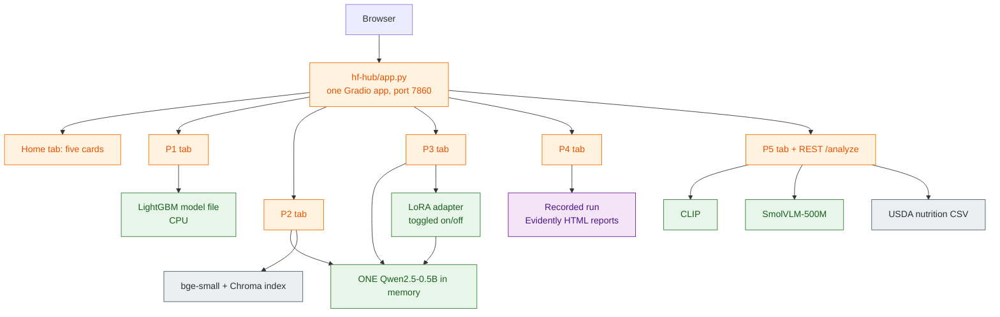
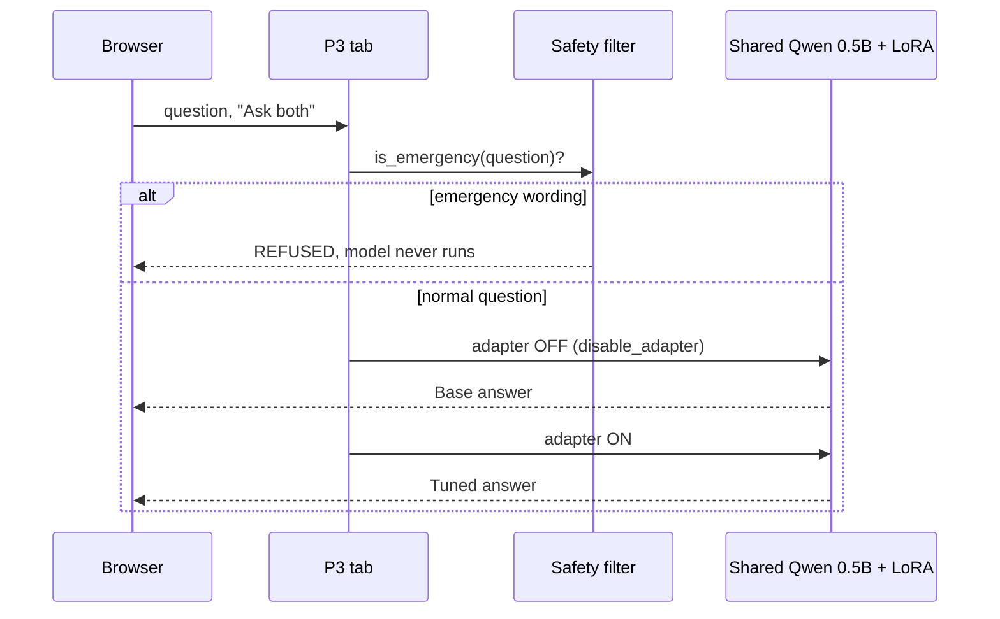
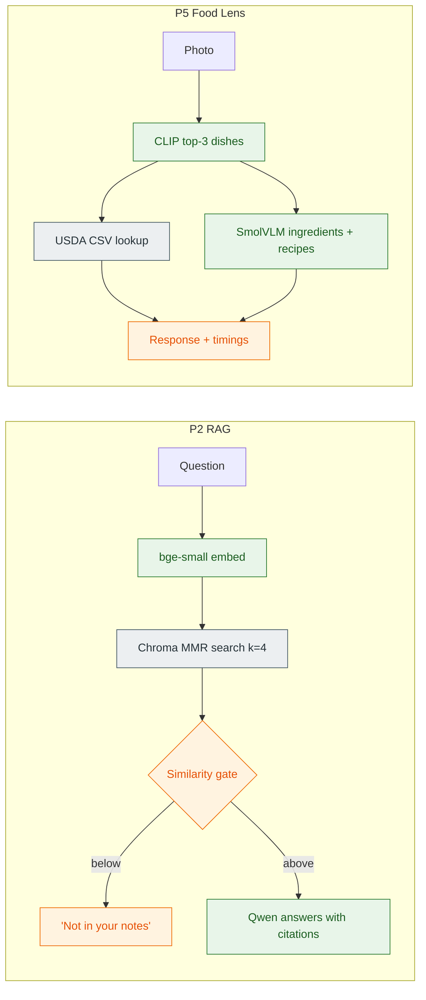
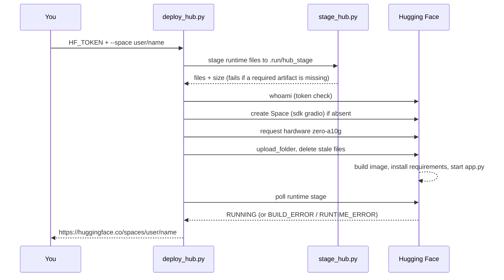

# AI Engineering Projects

Five small, production-shaped AI/ML projects, each runnable on its own and all served together as **one Hugging Face Space** (the "hub"). Every number below comes from a real run saved in that project's `reports/` folder.



*The deployed hub (Home tab). Pick a card, click **Open**, follow the short "How to use" at the top of the tab.*

> [!NOTE]
> Educational demos. P3 is not medical advice and P5 is not dietary advice. Models are small on purpose; answers can be wrong.

## Contents
1. [The five projects at a glance](#1-the-five-projects-at-a-glance)
2. [How the all-in-one hub works](#2-how-the-all-in-one-hub-works)
3. [How the models are used](#3-how-the-models-are-used)
4. [Core concepts for newcomers](#4-core-concepts-for-newcomers)
5. [Run a single project locally](#5-run-a-single-project-locally)
6. [Run the hub locally](#6-run-the-hub-locally)
7. [Deploy to Hugging Face Spaces](#7-deploy-to-hugging-face-spaces)
8. [Repository layout](#8-repository-layout)
9. [Safety: secrets and the zip](#9-safety-secrets-and-the-zip)
10. [Troubleshooting](#10-troubleshooting)
11. [Licenses](#11-licenses)

## 1. The five projects at a glance

| | Project | What it demonstrates | Model(s) | Real result | Runs on |
|---|---|---|---|---|---|
| P1 | [Student dropout risk](p1-e2e-ml-pipeline-dropout) | End-to-end tabular ML: train, track, serve, explain | LightGBM (trained here), SHAP | Test ROC-AUC 0.928, PR-AUC 0.903 | CPU, ms |
| P2 | [Study assistant](p2-rag-chatbot-study) | RAG chatbot with citations and a refusal gate | bge-small embeddings + Qwen2.5 | recall@4 0.792, refusal 7/7 | GPU slice |
| P3 | [Medical Q&A: base vs LoRA](p3-llm-finetuning-lora) | LoRA fine-tuning and an honest evaluation | Qwen2.5-0.5B + LoRA adapter | ROUGE-L 0.157 vs 0.154 (no gain) | GPU slice |
| P4 | [Fraud model monitoring](p4-model-monitoring-drift) | Drift detection and a retrain gate | LightGBM + Evidently | Baseline PR-AUC 0.801; alert on window 6 | Replay |
| P5 | [Food Lens](p5-multimodal-ai-food) | Multimodal: photo to dish, nutrition, recipes | CLIP + SmolVLM-500M | CLIP top-1 0.83, top-5 0.97 | GPU slice |

Each project folder has its own README (quickstart, results, limitations), `PLAN.md` and `DECISIONS.md`, and the same layout and `Makefile` targets (`python run.py <target>` on Windows).

## 2. How the all-in-one hub works

Locally, each project is a separate app with its own virtual environment, API and UI. On Hugging Face you get **one URL and one process**, so `hf-hub/` wraps all five into a single Gradio app with one tab per project.



**What the hub code does** (`hf-hub/`):

| File | Responsibility |
|---|---|
| `app.py` | Builds the tabbed Gradio app; grafts P5's REST routes (`/health`, `/analyze`) onto the same port; preloads shared models at startup |
| `hub/paths.py` | Puts every project's `src/` on `sys.path` (package names are unique, so one process can import all five) |
| `hub/loader.py` | Loads each project's `scripts/ui.py` under a unique module name (they would otherwise collide) |
| `hub/models.py` | Owns the single shared Qwen2.5-0.5B and the P2 embeddings + Chroma store |
| `hub/gpu.py` | `@spaces.GPU` decorator on Hugging Face, a no-op locally |
| `hub/tabs/p1..p5.py` | One module per tab: how-to text, examples, and the call into the project's own code |
| `hub/home.py`, `hub/theme.py` | Landing page cards and styling |

The hub imports the projects' real code; it does not reimplement it. Only the **runtime** files are shipped (code, config, trained model, adapter, Chroma index, small reports), staged by `scripts/stage_hub.py`. Datasets, virtual environments, MLflow runs and big HTML reports stay out.

> [!TIP]
> **ZeroGPU** — What: Hugging Face shares a pool of GPUs and attaches one only while a function marked `@spaces.GPU` runs. Why: free-ish GPU inference for demos. How we use it here: the P2, P3 and P5 inference functions carry `@gpu(60)` (60 s budget), and models are loaded once at startup (`HUB_PRELOAD=1`). The first request after a cold start is slower.

### What a request looks like (P3, base vs tuned)



## 3. How the models are used

Two kinds of models appear here: models **trained in this repo** (P1, P3's adapter, P4's classifier) and **pretrained models used off the shelf** (Qwen, bge-small, CLIP, SmolVLM). Weights are pinned by commit hash in each project's `configs/config.yaml`, so a rebuild fetches the same files.

| Project | Model | Role | Trained or pretrained | Notes |
|---|---|---|---|---|
| P1 | LightGBM | Scores dropout risk | Trained here (champion of 12 runs vs XGBoost) | SHAP TreeSHAP gives the top-3 features per student |
| P2 | `BAAI/bge-small-en-v1.5` | Turns text into vectors for search | Pretrained | Query instruction prefix is set in config |
| P2 | `Qwen/Qwen2.5-1.5B-Instruct` | Writes the answer from retrieved chunks | Pretrained | Standalone project; the hub uses 0.5B instead |
| P3 | `Qwen/Qwen2.5-0.5B-Instruct` + LoRA | Medical Q&A, base vs tuned | Pretrained base + adapter trained here | r=8, alpha=16, 1.08M trainable params (0.22%), MedQuAD data |
| P4 | LightGBM + Evidently | Fraud scoring and drift reports | Trained here | Drift share and PR-AUC drive the alert; challenger must beat champion |
| P5 | `laion/CLIP-ViT-B-32-laion2B-s34B-b79K` | Zero-shot dish name from a photo (Food-101 classes) | Pretrained | Class-name text embeddings cached |
| P5 | `HuggingFaceTB/SmolVLM-500M-Instruct` | Ingredients and recipe ideas | Pretrained | One short question per field, JSON assembled and validated |

### The sharing trick: one Qwen for P2 and P3
P2's fallback LLM and P3's base model are the **same pinned model** (Qwen2.5-0.5B-Instruct). On a Space with limited memory, loading it twice would waste RAM, so `hub/models.py`:
1. Loads the base model once, with P3's LoRA adapter attached.
2. Injects that object into P2's own lazy singleton (`llm._STATE`), so P2 finds a ready model.
3. Runs P2 with the adapter **disabled** (identical to the plain base model) and P3 with it toggled per request.
4. Asserts the two pinned revisions are equal at startup, so they cannot silently drift apart.
5. Guards all generation with one lock, because adapter on/off is global model state.

### Where nothing is generated
- **P5 nutrition** comes only from the USDA FoodData Central CSV; the VLM never invents numbers. Unmatched classes stay empty rather than guessed.
- **P2 refuses off-topic questions** before the LLM runs, using a similarity gate on retrieval scores.
- **P3 refuses emergencies** with a keyword safety filter before the LLM runs.
- **P4 on the hub is a replay** of a recorded run; it makes no live model call.

### How each project uses its models



## 4. Core concepts for newcomers

> [!TIP]
> **RAG (retrieval-augmented generation)** — What: look up relevant text first, then ask the LLM to answer from it. Why: small models forget facts and make things up; retrieved context grounds them and allows citations. How we use it here: P2 embeds 20 Wikipedia ML articles and two MIT OCW exams into Chroma, retrieves 4 chunks, and refuses when nothing is similar enough.

> [!TIP]
> **LoRA** — What: freeze the big model and train tiny add-on matrices (the adapter). Why: cheap (5 minutes on a laptop) and the adapter is a small file you can switch off. How we use it here: P3 compares adapter off vs on. The honest finding: answers got shorter (140 to 87 words) but ROUGE-L did not improve (0.157 vs 0.154).

> [!TIP]
> **Zero-shot classification (CLIP)** — What: CLIP puts images and text in one vector space, so you can classify against class names it was never trained on. Why: no labelled training set needed. How we use it here: P5 matches a photo against the 101 Food-101 dish names.

> [!TIP]
> **Drift and the retrain gate** — What: live data stops looking like training data. Why: accuracy silently decays, and labels arrive late. How we use it here: P4 watches the share of drifted features (no labels needed) plus PR-AUC once labels land, and only promotes a retrained challenger if it beats the champion by a margin.

> [!TIP]
> **Pinned revisions** — What: a model identifier plus an exact commit hash. Why: upstream repos change; pins make results reproducible. How we use it here: every model in `configs/config.yaml` carries a `revision`.

## 5. Run a single project locally

Needs macOS Apple Silicon (8 GB baseline), Python 3.11 and about 15 GB free disk. Toolchain details are in [SETUP.md](SETUP.md); build rules in [CLAUDE.md](CLAUDE.md).

```bash
cd p1-e2e-ml-pipeline-dropout            # or p2..p5
uv venv --python 3.11 .venv && source .venv/bin/activate
uv pip install -r requirements.txt
python run.py data train                 # build data and the model (targets vary per project)
python run.py demo                       # terminal demo
python run.py ui                         # Gradio UI
python run.py stop                       # when finished
```

| Project | Gradio | API docs |
|---|---|---|
| P1 | :7861 | :8000/docs (MLflow :5001) |
| P2 | :7860 | :8000/docs |
| P3 | :7863 | :8003/docs (MLflow :5003) |
| P4 | :7864 | :8004/docs (MLflow :5004) |
| P5 | :7865 | :8005/docs |

Run one project at a time on an 8 GB machine. After models are downloaded, set `HF_HUB_OFFLINE=1` to run fully offline.

## 6. Run the hub locally

The hub needs the artifacts that each project produces (P1 model, P2 Chroma index, P3 adapter, P4 recorded reports, P5 `data/nutrition.csv`), so build them first.

```bash
# 1. build each project's artifacts (see section 5), e.g. in p5:
cd p5-multimodal-ai-food && python run.py data && cd ..

# 2. stage only the runtime files into .run/hub_stage
python scripts/stage_hub.py

# 3. run the hub from the staged folder
cd .run/hub_stage
python -m venv .venv && source .venv/bin/activate
pip install -r requirements.txt
python app.py                            # http://127.0.0.1:7860

# 4. smoke-check every tab and the REST route (from the repo root)
python scripts/check_hub.py http://127.0.0.1:7860
```

> [!NOTE]
> The hub pins one deduplicated dependency set in `hf-hub/requirements.txt`. It uses `torch==2.8.0` (for ZeroGPU) whereas the local projects pin 2.5.1, so use a separate venv for the hub.

## 7. Deploy to Hugging Face Spaces

### One-time setup
1. Create a free account at [huggingface.co](https://huggingface.co).
2. Create an **access token** with **write** permission (Settings, Access Tokens).
3. ZeroGPU hardware needs a Hugging Face **PRO** account to host. Without it, run on CPU hardware (see the note below).
4. `pip install huggingface_hub==0.27.0`.

### Deploy
```bash
export HF_TOKEN=hf_xxx                     # in your shell only; never put it in a file
python scripts/deploy_hub.py --space <your-username>/ai-eng-projects
```

What `deploy_hub.py` does, in order:



Useful flags: `--hardware <name>` (default `zero-a10g`), `--no-upload` (stage only, to inspect what would ship).

### Verify the live Space
```bash
python scripts/check_hub.py https://<your-username>-ai-eng-projects.hf.space
```
It checks the page, P5's `/analyze`, a real P3 base-and-tuned answer, an emergency refusal, a P2 in-corpus answer with sources, a P2 off-topic refusal, and that P4's report links load.

### How the Space is configured
The YAML block at the top of `hf-hub/README.md` is the Space config: `sdk: gradio`, `sdk_version: 5.9.1`, `python_version: "3.11"`, `app_file: app.py`. Hugging Face reads it to build the container, so keep it in sync with `requirements.txt`.

### Deployment gotchas
- **Cold start:** the first answer can take about a minute while models load; the Space also sleeps when idle.
- **`/health` on Spaces:** the Spaces proxy reserves `/health`, so `check_hub.py` only tests it locally.
- **ZeroGPU pickles arguments:** GPU functions take plain values (P5 passes raw `bytes`), not model objects.
- **`import spaces` before `torch`:** `app.py` does this first on purpose.
- **Concurrency:** the queue runs one job at a time (`default_concurrency_limit=1`) to fit memory.
- **No PRO account:** pass `--hardware cpu-basic` or set it in the Space settings. The `@gpu` decorator becomes a no-op, but the LLM and VLM tabs will be slow and CPU-only operation has not been verified here.
- **Re-deploys:** `delete_patterns=["*"]` removes stale files from older versions of the Space, so the Space always mirrors the staged folder.
- **Tokens:** `HF_TOKEN` is read from the environment only and is never written anywhere.

## 8. Repository layout

```
.
├── README.md  SETUP.md  CLAUDE.md  PROGRESS.md
├── docs/                         screenshot and per-project specs
├── scripts/                      stage_hub.py  deploy_hub.py  check_hub.py
├── hf-hub/                       the all-in-one Space (app.py, hub/, requirements.txt, Space README)
├── p1-e2e-ml-pipeline-dropout/   tabular ML + SHAP + FastAPI
├── p2-rag-chatbot-study/         RAG with Chroma
├── p3-llm-finetuning-lora/       LoRA fine-tuning
├── p4-model-monitoring-drift/    drift monitoring and retrain gate
└── p5-multimodal-ai-food/        CLIP + USDA + SmolVLM
    └── (each) src/ tests/ scripts/ configs/ reports/ data/ artifacts/ README.md PLAN.md DECISIONS.md Makefile run.py
```

## 9. Safety: secrets and the zip

- No secrets are stored in the repo. `.env` files are gitignored; only `.env.example` ships. Tokens (`HF_TOKEN`) live in your shell environment.
- `data/`, `artifacts/`, `mlruns/`, `chroma/`, `*.db`, `.venv/` and `.run/` are gitignored and excluded from the shareable zip. Recreate them with the project's `data` and `train` targets.
- Never paste a token into an issue, a commit or a Space file.

## 10. Troubleshooting

| Symptom | Likely cause and fix |
|---|---|
| Port 5000 busy | macOS AirPlay Receiver; MLflow here uses 5001 and up |
| LightGBM import error | `brew install libomp` |
| `stage_hub.py` says "missing required" | Run that project's `data` / `train` step first |
| Space shows `BUILD_ERROR` | Open Logs; usually a pin that does not resolve; compare with `hf-hub/requirements.txt` |
| Space shows `RUNTIME_ERROR` on start | Missing staged artifact (adapter, Chroma, `nutrition.csv`); re-run staging and inspect with `--no-upload` |
| First answer very slow | Cold start and model load; retry once |
| Out of memory locally | Run one project at a time; use the default `small` profile |

## 11. Licenses

Code: MIT. Models: Qwen2.5 and SmolVLM Apache-2.0; CLIP weights (laion2B) MIT; bge-small MIT. Data: USDA FoodData Central is US public domain; Wikipedia text CC BY-SA; MIT OCW exams CC BY-NC-SA 4.0; MedQuAD CC BY 4.0. See each project's README for details.
