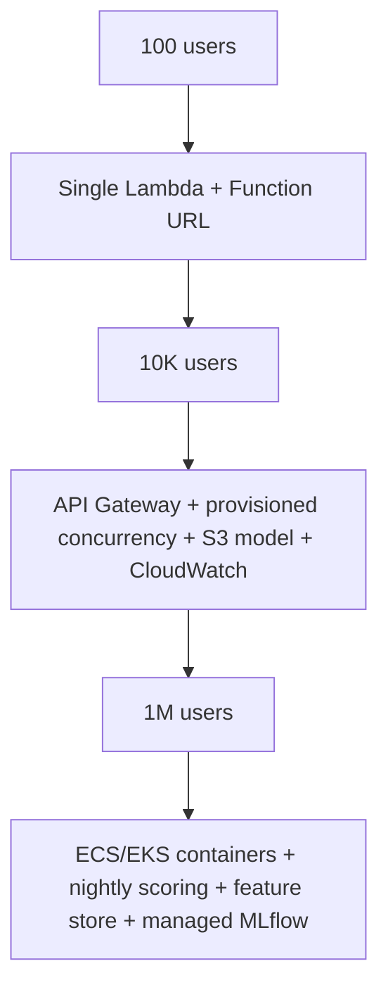

# P1: Student Dropout Risk

## Goal
Build a small but complete ML project that can:
- read student data,
- train a model to predict dropout risk,
- track experiments with MLflow,
- serve the model with FastAPI,
- and optionally deploy it to AWS Lambda.

This project teaches the full ML lifecycle in a simple, practical way.

## Core ideas
We will learn:
- data quality and leakage checks,
- stratified train/validation/test splits,
- class imbalance handling,
- gradient boosting models,
- ROC-AUC vs PR-AUC vs recall,
- threshold tuning,
- model tracking and registry,
- SHAP-style feature explanations,
- fairness checks,
- serverless packaging.

## Data
Use the UCI dataset:
- "Predict Students' Dropout and Academic Success"
- dataset id: 697
- license: CC BY 4.0
- rows: 4,424
- features: 36

Target classes:
- Dropout
- Enrolled
- Graduate

Extra package pins:
- `lightgbm==4.5.0`
- `xgboost==2.1.3`
- `ucimlrepo==0.0.7`
- `mangum==0.19.0`
- `boto3==1.35.90` (only if Lambda is used)

Need:
- `brew install libomp`

For explanations, use LightGBM built-in feature contribution output instead of `shap`.

MLflow settings:
- database: `sqlite:///mlflow.db`
- artifacts folder: `./mlruns`
- UI port: `5001`

## Executive summary

This project turns a real student dataset into a production-style ML workflow:
- clean and validate the data,
- compare models,
- pick a threshold for business value,
- track results in MLflow,
- serve predictions through an API,
- and optionally package the same service for AWS Lambda.

## Project flow


## Phases

### Phase 1: Data pipeline
Goal: prepare clean and reliable data.

Tasks:
- fetch the dataset into `data/raw`
- rename columns to snake_case
- check schema and value ranges
- fail loudly on bad data
- create a stratified 70/15/15 split
- save split data as parquet files
- build `scripts/eda.py`
- generate `reports/eda.md`

What to include in EDA:
- class balance
- missing values
- top correlations

Acceptance:
- total split rows equal 4,424
- `reports/eda.md` exists

---

### Phase 2: Model training and tracking
Goal: train good models and keep full records of results.

Tasks:
- compare LightGBM and XGBoost
- handle class imbalance with class weights
- run a small grid search with at most 12 total runs
- choose the validation threshold that maximizes recall while keeping precision at least 0.6
- log all metrics to MLflow
- save confusion matrix and feature importance plots
- register the best model as `dropout-risk`
- set alias to `champion`
- export the serving model files:
  - `artifacts/model/model.txt`
  - `preprocess.json`

What to log:
- parameters
- ROC-AUC
- PR-AUC
- F1
- recall at threshold
- confusion matrix
- feature contribution plot
- model signature
- input example

Fairness reporting:
- group metrics by gender
- group metrics by age band
- save summary in `reports/fairness.md`

Acceptance:
- metrics saved in `reports/metrics.json`
- runs visible in MLflow UI

---

### Phase 3: Local serving
Goal: expose the model through a fast local API.

Build endpoints:
- `GET /health`
- `POST /predict`
- `POST /predict/batch`

Each prediction should return:
- probability
- risk tier (`low`, `medium`, `high`)
- top 3 contributing features
- model version

Use:
- FastAPI
- Pydantic schemas with clear field descriptions
- optional small Gradio form that calls the API

Acceptance:
- TestClient tests pass
- `make smoke` passes
- p50 latency saved in `reports/latency.md`

---

### Phase 4: Optional Lambda deployment
Goal: run the same model behind AWS Lambda without Docker.

This part is optional and should only be done after a clear yes.

Requirements:
- use Mangum
- test the handler in-process with a sample API Gateway event
- no Docker and no emulator
- zip the deployment package
- keep package size under 250 MB unzipped

Build command idea:
```bash
uv pip install --python-platform aarch64-manylinux2014 \
  --python-version 3.11 \
  --only-binary :all: \
  --target build/lambda \
  -r requirements-lambda.txt
```

The package should include only the needed runtime pieces, such as:
- lightgbm
- numpy
- fastapi
- mangum
- pydantic

Also add:
- `scripts/deploy_lambda.py`
- AWS credentials check before deployment
- teardown script
- note on free-tier cost

Acceptance:
- in-process Lambda handler returns a valid prediction
- package size is reported

---

### Phase 5: Verify and document
Goal: finish the project cleanly.

Final steps:
- run verification checks
- confirm everything works
- write the project README

## Key design decisions to confirm
We should ask these before coding:
1. Binary target or 3-class target?
2. Keep sensitive features like gender in the model or remove them?
3. Do we build the optional Lambda stage?
4. Do we deploy to real AWS or only test locally?

## Important limits to document
This project has real-world limits:
- data comes from one institution in Portugal
- the snapshot is taken during enrollment, not across the full student life cycle
- correlation does not mean causation
- labeling students as at risk can create ethical concerns

## Scaling view



Scale path:
- 100 users: simple Lambda service
- 10K users: better API gateway and scaling controls
- 1M users: container-based serving and stronger ML ops

## Expected outcomes
By the end, the project should provide:
- cleaned student dataset
- model comparison and selected champion model
- tracking in MLflow
- local prediction API
- optional Lambda deployment
- guided explanations of fairness and risk

## Deliverables
- data pipeline
- training script
- evaluation reports
- API service
- optional serverless deployment
- README and verification notes

## Summary
This project is a good beginner-friendly ML system because it starts with real data, teaches the full workflow, and ends with a working local app. It also keeps the scope realistic for a MacBook with Apple Silicon and no Docker.
