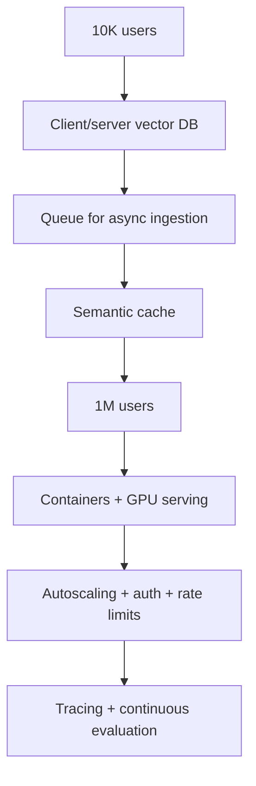

# P2: Study Assistant

## Goal
Build a local study chatbot that answers only from course notes and past exam papers.
It should:
- ground every answer in the sources,
- show citations,
- refuse answers that are not in the provided materials,
- run fully on the laptop without outside APIs.

This is a practical example of a retrieval-augmented generation (RAG) system.

## What this project teaches
We will learn:
- why RAG is useful instead of only fine-tuning a model,
- how to load documents from files and PDFs,
- how to split documents into useful chunks,
- how embeddings turn text into numbers,
- how vector search finds similar content,
- how to reduce duplicated or low-quality retrieval results,
- how to keep answers grounded in the source text,
- how to handle conversation history,
- how to stream answers to the user,
- how to test retrieval quality.

## Key terms and simple definitions
- RAG: Retrieval-Augmented Generation. First find the relevant text, then ask the model to answer using only that text.
- Embedding: a numerical representation of text that captures meaning.
- Vector database: a database built to search for similar embeddings quickly.
- Chunking: splitting long documents into smaller pieces so the model can work with them well.
- MMR: Maximal Marginal Relevance. A retrieval method that balances relevance and diversity.
- Grounding: making the model answer only from the source documents.
- Hallucination: when a model makes up facts or invents a response.

## Data and model setup
### Corpus
The app builds its corpus from:
- `data/corpus/notes/`: about 20 Wikipedia articles on one subject, downloaded as markdown
- `data/corpus/exams/`: 2–3 open-licensed past exam PDFs
- user-provided PDFs or markdown files can also be added later

### Package pins
- `langchain==0.3.13`
- `langchain-huggingface==0.1.2`
- `langchain-chroma==0.1.4`
- `chromadb==0.5.23`
- `pypdf==5.1.0`

### Local model setup
Use:
- Chroma embedded database stored in `./chroma`
- embedding model: `BAAI/bge-small-en-v1.5` (about 130 MB, runs on MPS)
- LLM: `Qwen/Qwen2.5-1.5B-Instruct` by default
- fallback: `Qwen/Qwen2.5-0.5B-Instruct` if memory is tight

The app should keep a small context budget:
- 4 chunks + short history
- under 3,000 tokens total
- `max_new_tokens` around 400

## Executive summary

This project is a local study assistant that only answers from trusted course materials.
It uses a retrieval pipeline to find the right notes or exam questions, then asks the model
for a grounded answer with citations.

## Project flow

```mermaid
flowchart LR
    A[Build corpus] --> B[Chunk docs]
    B --> C[Embed chunks]
    C --> D[Index in Chroma]
    D --> E[Retrieve relevant chunks]
    E --> F[Grounded answer with citations]
    F --> G[Stream response in API + UI]
    G --> H[Evaluate quality]

    classDef data fill:#E3F2FD,stroke:#1565C0,color:#0D47A1
    classDef embed fill:#E8F5E9,stroke:#2E7D32,color:#1B5E20
    classDef answer fill:#FFF3E0,stroke:#EF6C00,color:#E65100
    classDef eval fill:#F3E5F5,stroke:#6A1B9A,color:#4A148C

    class A,B,C,D data
    class E,F embed
    class G answer
    class H eval
```

## Phases

### Phase 0b: Download models
Goal: prepare the local retrieval and generation models.

Tasks:
- download the embedding model
- download the selected Qwen model
- save the chosen runner version in the project config

Acceptance:
- model download script runs successfully
- local model files are available for the project

---

### Phase 1: Ingest documents
Goal: turn raw files into clean, searchable chunks.

Tasks:
- load markdown files and PDF files
- capture metadata such as:
  - source
  - page
  - document type (`notes` or `exam`)
  - year
- split notes with a recursive chunker
- split exam documents by question, with a fallback to recursive splitting if needed
- keep stable content hashes so re-running ingestion does not create duplicates

Example chunking strategy:
- notes: chunk size around 800 with overlap around 120
- exams: split by question pattern when possible

Acceptance:
- ingest report exists in `reports/ingest.md`
- re-running ingestion adds zero duplicates

---

### Phase 2: Build the index
Goal: store text in a vector database ready for search.

Tasks:
- generate embeddings for each chunk
- store them in Chroma
- test retrieval with 3 sample questions
- view the top 4 results for each query

Acceptance:
- retrieval probe results saved in `reports/probe.md`
- results are relevant to the test questions

---

### Phase 3: Build the RAG answer flow
Goal: answer questions only from the retrieved text.

Tasks:
- condense the current question with chat history
- retrieve the top 4 relevant chunks with MMR search
- optionally filter by document type
- build a grounded prompt using the source chunks
- cite each answer as `[source:page]`
- if a question is not supported, say: "not in your notes"
- stream the answer with `TextIteratorStreamer`

Acceptance:
- 3 in-corpus questions are answered with citations
- 2 out-of-corpus questions are refused properly

---

### Phase 4: API and UI
Goal: give the chatbot a usable front end.

Build endpoints:
- `POST /ingest`
- `POST /ask` with streaming response
- `GET /health`

Also add:
- a Gradio chat interface
- source citations in the UI
- a document-type filter for notes vs exam papers

Acceptance:
- the API can answer questions and stream the result
- the UI displays source citations clearly

---

### Phase 5: Evaluation
Goal: measure whether the system is actually useful.

Tasks:
- create `eval/qa.jsonl` with 20 questions
- draft them from real chunks in the corpus
- store gold chunk IDs for checking retrieval quality
- have the user review the questions before use

Measure:
- recall@4
- MRR
- citation rate
- refusal accuracy

Save the results in `reports/eval.json`.

Acceptance:
- evaluation file exists
- the metrics make sense for a local retrieval system

---

### Phase 6: Verify and document
Goal: finish the project cleanly.

Final steps:
- run verification checks
- confirm the app is working
- write the project README

## Decisions to ask
Before building, confirm:
1. Which subject should the corpus cover?
2. Which exam PDF URLs should be used?
3. Should the default model be `Qwen2.5-1.5B` or the smaller `Qwen2.5-0.5B`?

## Limits to document
This project has some practical limits:
- small models can still reason poorly on hard questions
- PDFs with tables or equations may be hard to parse
- no OCR support means scanned pages are not ideal
- the system is English-focused

## Scaling view

Scale path:
- 10K users: move the vector DB and retrieval layer to a proper server setup
- 1M users: add containers, GPU serving, stronger monitoring, and multi-tenant handling

## Expected outcome
By the end, the project should provide:
- a local study assistant that answers from course sources,
- citations for supported answers,
- safe refusal for unsupported questions,
- a working API and web UI,
- evaluation metrics for retrieval quality.

## Summary
This project teaches a very common real-world pattern: use a smart retriever to find the right source text, then use a language model to answer only from that text. That helps reduce made-up responses and makes the assistant more trustworthy.
