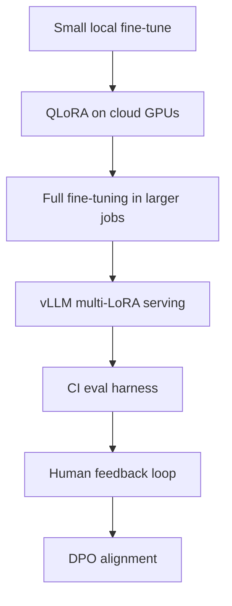

# P3: Adapting a Foundation Model

## Goal
Fine-tune a small open model on a domain-specific Q&A task, compare it to the base model, and serve it locally on a Mac with MPS.

This project teaches how to adapt a model without doing a full retrain from scratch.

## What this project teaches
We will learn:
- when prompting is enough and when adaptation is needed,
- how RAG differs from fine-tuning,
- what PEFT and LoRA are,
- how chat templates shape model input,
- how to check overfitting and forgetting,
- how to evaluate model quality honestly,
- how adapters and merged weights differ.

## Key terms and simple definitions
- PEFT: Parameter-Efficient Fine-Tuning. A way to train only a small part of the model.
- LoRA: Low-Rank Adaptation. A technique that learns small trainable updates instead of changing the whole model.
- SFT: Supervised Fine-Tuning. Training a model on labeled input-output pairs.
- Adapter: a small extra set of model weights used to specialize the model.
- Catastrophic forgetting: when a model loses its older knowledge after being trained on a new task.
- ROUGE: a metric to compare generated text with reference text.

## Domain choices
Default domain:
- medical Q&A using the MedQuAD dataset

Alternative domain:
- finance Q&A using a finance-alpaca dataset

Base model:
- `Qwen/Qwen2.5-0.5B-Instruct`

Package pins:
- `peft==0.14.0`
- `trl==0.13.0`
- `evaluate==0.4.3`
- `rouge-score==0.1.2`

Training device:
- MPS
- `fp32` for stability

Profiles:
- small: 300 train / 50 validation / 50 test
- standard: 2,000 train / 200 validation / 100 test

## Executive summary

This project shows how a small model can be adapted to a new domain with a lightweight LoRA
training loop. It compares the tuned model with the base model honestly and exposes the result
through a local API.

## Project flow

## Phases

### Phase 1: Prepare the dataset
Goal: make the domain data ready for fine-tuning.

Tasks:
- load the dataset
- clean duplicate or broken examples
- remove examples over 384 tokens
- format the examples using the chat template
- split into deterministic train/validation/test sets
- save summary stats in `reports/data.md`

Acceptance:
- dataset summary exists
- data length distribution is shown clearly

---

### Phase 2: Build the baseline
Goal: measure the base model before adaptation.

Tasks:
- run the base model on the test set
- use greedy decoding with `max_new_tokens` around 200
- report:
  - ROUGE-L
  - average answer length
  - 10 fixed qualitative prompts
- save results in `reports/baseline.json`

Acceptance:
- baseline metrics are recorded
- the output is honest even if the base model performs poorly

---

### Phase 3: Train the LoRA adapter
Goal: adapt the model with lightweight training.

Use:
- TRL `SFTTrainer`
- LoRA settings such as:
  - `r=8`
  - `alpha=16`
  - dropout `0.05`
  - target modules: `q`, `k`, `v`, `o_proj`
- learning rate `2e-4`
- 1 epoch
- batch size 1
- gradient accumulation 8
- gradient checkpointing
- save periodically
- support resume from checkpoint
- MLflow tracking

Also print an estimated training time first and check whether it is above 60 minutes.

Acceptance:
- loss curve is logged
- adapter is saved in `artifacts/adapter`

---

### Phase 4: Evaluate the tuned model
Goal: compare the tuned model to the base model.

Tasks:
- run both models on the same test set
- compare side-by-side metrics
- test the same fixed prompts on both models
- check whether the tuned model forgets general knowledge
- save the comparison in `reports/compare.md`

Include:
- 10 general knowledge prompts
- a clear note if the tuned model does not improve

Acceptance:
- base vs tuned comparison is saved
- the report is honest and evidence-based

---

### Phase 5: Serve the model locally
Goal: expose the model through a local API and UI.

Requirements:
- keep one base model in memory
- load the LoRA adapter only for tuned answers
- use `model.disable_adapter()` for base responses
- create a FastAPI endpoint `/generate` with `mode=base|tuned`
- build a Gradio side-by-side UI
- add a domain system prompt and a safety disclaimer
- refuse emergency-related requests or unsafe prompts
- save a merged version in `artifacts/merged` for easier portability

Acceptance:
- the app can generate with either base or tuned mode
- a merged model artifact is stored

---

### Phase 6: Verify and document
Goal: finish the project with a clean, reliable result.

Final steps:
- run validation checks
- confirm the adapter works
- write the final README

## Decisions to ask
Before implementation, confirm:
1. Use the medical dataset or the finance dataset?
2. Use the small or standard data profile?

## Limits to document
This project has real constraints:
- a 0.5B model is small and may not reason deeply
- ROUGE is not the same as real correctness
- the model is not a medical or financial advisor
- dataset bias can affect the learned style and outputs

## Scaling view

Scale path:
- start with local LoRA work
- move to larger GPU jobs for training
- use multi-LoRA serving when many domain adapters are needed

## Expected outcome
By the end, the project should provide:
- a cleaned domain Q&A dataset,
- a working LoRA fine-tuning pipeline,
- an honest baseline-vs-tuned evaluation,
- a local API and UI,
- a practical understanding of model adaptation.

## Summary
This project shows a simple but important idea: we do not need to retrain a whole model to adapt it. LoRA gives us a much lighter and more practical route, especially when working on a laptop with limited compute.
