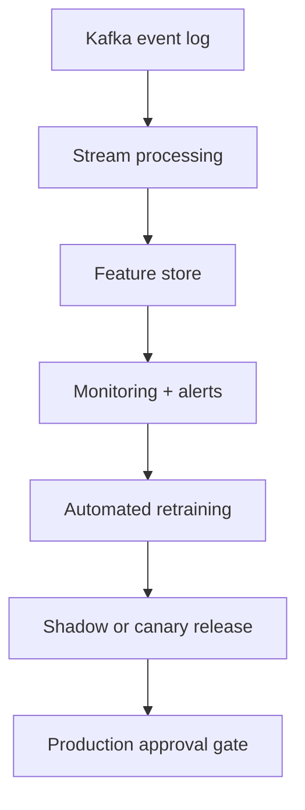

# P4: Fraud Model Monitoring

## Goal
Build a fraud detection system that:
- serves a model locally,
- logs prediction data,
- simulates a new fraud pattern,
- detects drift and performance decay,
- raises alerts,
- retrains a challenger model when needed.

This project teaches how machine learning models can silently become worse over time.

## What this project teaches
We will learn:
- why models decay after deployment,
- the difference between data drift, prediction drift, and concept drift,
- how to compare a reference dataset with a new production window,
- how to handle delayed labels,
- why precision and recall matter more than raw accuracy when fraud is rare,
- how monitoring and alerting work in production,
- how to run a champion/challenger retraining loop.

## Key terms and simple definitions
- Data drift: the distribution of input data changes over time.
- Concept drift: the relationship between features and labels changes.
- Reference window: a clean historical period used as a baseline.
- Current window: the recent period being checked for change.
- Precision: of the predicted frauds, how many were actually fraud.
- Recall: of the actual frauds, how many were found.
- PSI / KS / Wasserstein: statistical tests used to measure differences between distributions.
- Alert fatigue: too many alerts, so the team stops paying attention.

## Data and setup
Use the OpenML credit card fraud dataset:
- 284,807 rows
- fraud rate: about 0.17%
- features: PCA-transformed values plus `Time` and `Amount`

Use a time-based split:
- first 60% = reference/training data
- remaining 40% = production stream

Package pins:
- `lightgbm==4.5.0`
- `evidently==0.4.40`

Need:
- `brew install libomp`

Use:
- SQLite for prediction logging
- MLflow for model tracking and registry
- Gradio for the dashboard

## Executive summary

This project builds a monitoring loop around a fraud model. It logs predictions, simulates drift,
detects bad behavior, raises alerts, and retrains a challenger when needed.

## Project flow

```mermaid
flowchart LR
    A[Train baseline fraud model] --> B[Serve API and log predictions]
    B --> C[Replay production stream]
    C --> D[Detect drift and performance drop]
    D --> E[Raise alerts]
    E --> F[Train challenger model]
    F --> G[Promote if better]

    classDef model fill:#E8F5E9,stroke:#2E7D32,color:#1B5E20
    classDef serve fill:#FFF3E0,stroke:#EF6C00,color:#E65100
    classDef drift fill:#F3E5F5,stroke:#6A1B9A,color:#4A148C
    classDef alert fill:#E3F2FD,stroke:#1565C0,color:#0D47A1

    class A model
    class B,C serve
    class D,E drift
    class F,G alert
```

## Phases

### Phase 1: Build the baseline model
Goal: create an initial fraud detection model and track it.

Tasks:
- train a LightGBM model
- use PR-AUC as the main metric, because normal accuracy is not useful when fraud is rare
- explain the issue clearly in the project docs
- register the model as the champion in MLflow
- save a baseline report in `reports/baseline.json`

Acceptance:
- baseline model is trained and tracked
- report exists

---

### Phase 2: Serve the model and log predictions
Goal: make a live API that logs all predictions.

Create endpoints:
- `POST /predict`
- `POST /feedback`
- `GET /health`

Log for each prediction:
- request ID
- features
- score
- model version
- timestamp

Store logs in SQLite so later monitoring can use them.

Acceptance:
- API works locally
- prediction log is stored
- delayed labels can be attached later through the feedback endpoint

---

### Phase 3: Simulate drift
Goal: create realistic production drift scenarios.

Use configurable scenarios in `scripts/scenarios.py`:
- scenario A: feature shift, such as `Amount × 3` with noise
- scenario B: a new fraud pattern appears in a feature region not seen during training
- scenario C: a concept drift where labels flip in a segment

Document the exact generation method for each scenario.

Acceptance:
- the stream can be replayed as a sequence of days
- the chosen scenario starts at a defined day

---

### Phase 4: Monitoring job
Goal: detect drift and falling performance before it gets too late.

Tasks:
- run monitoring in windows
- generate Evidently reports
- check drift signals using Data Drift, Target Drift, and Classification presets
- compare current and reference windows
- save HTML reports in `reports/windows/`
- write summary status to `status.json`
- raise alerts if:
  - drift share is greater than 0.3, or
  - PR-AUC drops by more than 10%
- log alerts to `reports/alerts.jsonl`

Acceptance:
- scenario B is detected within two windows of the injection point
- clean windows do not trigger alerts

---

### Phase 5: Dashboard
Goal: make the monitoring results easy to view.

Build a Gradio dashboard that shows:
- drift share over time
- PR-AUC over time
- alert markers
- links to window reports

Acceptance:
- dashboard renders monitoring signals clearly
- users can inspect the report history quickly

---

### Phase 6: Retraining loop
Goal: upgrade the model when a challenger is better.

Tasks:
- train a challenger model using reference data plus recent labeled examples
- compare the challenger to the champion on the latest production window
- promote only if the challenger is clearly better
- log both models in MLflow

Acceptance:
- retraining loop is implemented
- model promotion logic is explicit

---

### Phase 7: Verify and document
Goal: finish the project with strong evidence.

Final steps:
- run verification checks
- confirm the monitoring logic works
- write the project README

## Decisions to ask
Before implementation, confirm:
1. Use Evidently 0.4.40 legacy API or a newer version?
2. What alert thresholds should we start with?
3. What sample size should the small profile use for the stream?

## Limits to document
This project has important boundaries:
- the dataset uses anonymized PCA features, so the raw behavior is less interpretable
- the drift scenarios are synthetic, not real-world fraud patterns
- the project monitors batches rather than true streaming systems

## Scaling view

Scale path:
- add event streaming for high-throughput systems
- use a feature store for consistent training and serving data
- add Prometheus, Grafana, and Alertmanager for better operability
- use shadow or canary deployment before full promotion

## Expected outcome
By the end, the project should provide:
- a working fraud model service,
- prediction logging,
- drift detection,
- alerts for performance decay,
- retraining logic for champion/challenger updates.

## Summary
Fraud models are not static. They drift, the fraud pattern changes, and the score quality can silently degrade. This project shows how to monitor the model, detect the drop, and build a disciplined retraining loop.
