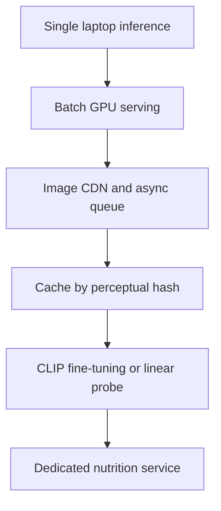

# P5: Multimodal Food Lens

## Goal
Build a local app that accepts a food photo and returns:
- the most likely dish,
- nutrition values per 100 g from a trusted source,
- recipe ideas,
- a short explanation of the prediction.

The app should be grounded in retrieved facts, not just a model guessing freely.

## What this project teaches
We will learn:
- how multimodal AI combines images and text,
- what CLIP is and why shared embedding spaces matter,
- how zero-shot classification works,
- how a vision-language model reads an image and explains it,
- why grounding prevents hallucinated nutrition numbers,
- how to validate structured JSON outputs,
- how to manage latency on a laptop.

## Key terms and simple definitions
- Multimodal AI: AI that works with more than one type of input, such as images and text.
- CLIP: a model that learns to connect text and images in the same space.
- Zero-shot classification: classifying an image using labels without training on that exact dataset.
- VLM: Vision-Language Model. A model that can read both an image and a text prompt.
- Grounding: using real facts or data as the source of truth instead of trusting the model to invent numbers.
- Hallucination: when the model makes up information that is not supported by facts.

## Model and package setup
Package pins:
- `open_clip_torch==2.29.0`
- `pillow==11.0.0`

Models:
- CLIP ViT-B-32 with `laion2b_s34b_b79k`
- default VLM: `Qwen/Qwen2-VL-2B-Instruct`
- fallback: `HuggingFaceTB/SmolVLM-500M-Instruct`

Important note:
- Do not use `Qwen2.5-VL` because it needs newer transformers than the pinned version.

Evaluation dataset:
- Food-101 from Hugging Face
- 101 food classes
- use a streamed validation sample rather than downloading the full 5 GB dataset

## Executive summary

This project turns an image into a useful answer: dish prediction, nutrition facts, and recipe ideas.
It keeps the nutrition data grounded in a trusted source so the app avoids making up numbers.

## Project flow

```mermaid
flowchart LR
    A[Upload food photo] --> B[Use CLIP for top classes]
    B --> C[Look up nutrition facts]
    C --> D[Pass top labels + image to VLM]
    D --> E[Validate structured JSON]
    E --> F[Return dish, nutrition, and recipe ideas]

    classDef vision fill:#E3F2FD,stroke:#1565C0,color:#0D47A1
    classDef facts fill:#E8F5E9,stroke:#2E7D32,color:#1B5E20
    classDef reason fill:#FFF3E0,stroke:#EF6C00,color:#E65100
    classDef verify fill:#F3E5F5,stroke:#6A1B9A,color:#4A148C

    class A,B vision
    class C facts
    class D,E reason
    class F verify
```

## Phases

### Phase 0b: Download models
Goal: set up the local vision pipeline.

Tasks:
- download CLIP model files
- download the chosen VLM
- save model revisions in the project setup

Acceptance:
- model download script works
- model files are available locally

---

### Phase 1: Build the classifier
Goal: predict likely food classes from the image.

Tasks:
- run CLIP in zero-shot mode
- build prompt ensembles for each food label
- cache text embeddings to `.npy`
- evaluate top-1 and top-5 accuracy on the streamed validation sample
- save results to `reports/clip_eval.json`

Acceptance:
- the classifier returns likely dish labels
- the evaluation file exists

---

### Phase 2: Nutrition database
Goal: connect the predicted dish to real nutrition values.

Tasks:
- query the USDA FoodData Central API
- use `FDC_API_KEY` if available, or a demo key as fallback
- build `data/nutrition.csv`
- save fields such as:
  - kcal
  - protein
  - fat
  - carbs
  - fiber
  - `fdc_id`
  - matched description
- create a `mapping_review.csv` for human review

Important rule:
- never invent a nutrition value
- if data is missing, keep it as null

Acceptance:
- nutrition table exists
- values come from a trusted source, not from the model

---

### Phase 3: VLM reasoning
Goal: produce a grounded answer from the image and the nutrition table.

The VLM should receive:
- the input image
- the top 3 CLIP predictions
- the nutrition rows for the matched dish

The model should return JSON like:
- `dish`
- `why`
- `visible_ingredients`
- `portion_estimate` (marked as estimate)
- `recipes` with 2 item suggestions

Important rule:
- nutrition values must always come from the CSV, never from the VLM
- use the project’s structured output rule:
  - JSON-only prompt
  - extract first JSON object
  - validate with Pydantic
  - retry once if validation fails

Memory plan:
- in the `standard` profile, load both CLIP and the VLM together
- in the `small` profile, free CLIP memory before loading the VLM, or use SmolVLM instead

Acceptance:
- a structured response is returned
- nutrition values remain sourced from the database

---

### Phase 4: API
Goal: provide a local endpoint for image analysis.

Create a FastAPI endpoint:
- `POST /analyze`

Requirements:
- accept multipart image upload
- keep image size within 5 MB
- resize to no more than 768 px on the longest side
- return stage timings for each step

Acceptance:
- the API can analyze an uploaded food photo
- response timing is included

---

### Phase 5: UI
Goal: make the app easy to use.

Build a Gradio interface with:
- upload or webcam input
- top-3 prediction bar chart
- nutrition table with USDA source link
- recipe ideas
- disclaimer for nutrition estimates

Acceptance:
- users can upload a photo and get a complete answer
- the interface is readable and understandable

---

### Phase 6: Verify and document
Goal: finish the app cleanly.

Final steps:
- run verification checks
- confirm the app works on the local machine
- write the final README

## Decisions to ask
Before implementation, confirm:
1. Use the default `Qwen2-VL-2B` or the smaller `SmolVLM-500M`?
2. Does the user have an FDC API key for USDA data?

## Limits to document
This project has real limits:
- mixed plates are harder to classify correctly
- regional or uncommon dishes may not be in Food-101
- portion estimation is not reliable
- local laptop latency may be slower than a cloud GPU

## Scaling view

Scale path:
- start with local inference on a laptop
- move to GPU servers for higher throughput
- add caching and background image processing for production use

## Expected outcome
By the end, the project should provide:
- a real food image analysis app,
- a likely dish prediction,
- grounded nutrition values,
- recipe suggestions,
- a working local API and interface.

## Summary
This project is a good example of multimodal AI in practice: use a fast image classifier to narrow the likely food type, then use a vision-language model to reason with the image and trusted data. That helps keep the answer useful and less likely to invent nutrition values.
