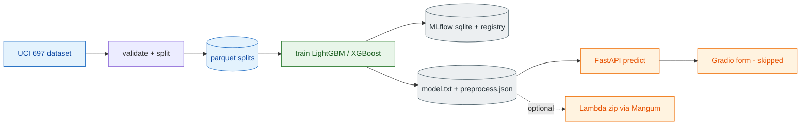

# P1 Student Dropout Risk — Plan

## Goal
Predict student dropout risk (UCI 697, 4,424 rows, CC BY 4.0) and serve it as a local FastAPI
service with MLflow tracking and registry. Optional AWS Lambda packaging (no Docker).

## Architecture

## Components (exact versions; dry-run resolved on Python 3.11 arm64)
| Component | Version |
|---|---|
| Python | 3.11.11 (uv 0.5.11) |
| pandas / numpy / scikit-learn | 2.2.3 / 1.26.4 / 1.5.2 |
| lightgbm / xgboost | 4.5.0 / 2.1.3 (needs brew libomp, present) |
| mlflow | 2.19.0 (sqlite, UI port 5001) |
| fastapi / uvicorn / pydantic | 0.115.6 / 0.32.1 / 2.10.3 |
| gradio | 5.9.1 (port 7860) - UI skipped, see DECISIONS.md |
| ucimlrepo / pyarrow | 0.0.7 / 18.1.0 (pyarrow added for parquet, see DECISIONS.md) |
| Lambda only (phase 4, separate requirements-lambda.txt) | mangum 0.19.0 (no boto3, D4) |

## Phases and acceptance
1. Data — fetch, snake_case, schema/range checks, stratified 70/15/15 parquet, eda.md. Accept: counts sum to 4,424; eda.md exists; unit tests for validation + stratification.
2. Train — LGBM vs XGB, class weights, ≤12 runs, threshold on val (recall at precision ≥ 0.6, fallback best-F1), MLflow logging, register `dropout-risk`@`champion`, export model.txt + preprocess.json (incl. model_version), fairness.md. Accept: reports/metrics.json; runs in MLflow UI; PR-AUC above base rate.
3. Serve — /health, /predict, /predict/batch (≤100), tiers, top-3 contributions, optional Gradio. Accept: TestClient tests, `make smoke`, p50 latency in reports/latency.md.
4. Lambda (optional) — Mangum handler, in-process event test, aarch64 package <250 MB, deploy only with confirmed AWS credentials.
5. /verify then /readme.

## Budget (small profile, 8 GB)
Data is tiny: peak RAM < 1.5 GB for training (n_jobs=2); train grid a few minutes; API < 300 MB. Recorded in reports/resources.md.

## Risks and mitigations
- Leakage / prediction point (semester features are post-enrollment) → decision D1, leakage test.
- Serving only supports LightGBM → export LightGBM only; XGBoost is a tracked comparison.
- Infeasible precision ≥ 0.6 → fallback to best-F1 threshold, recorded in preprocess.json.
- Lambda libgomp / aarch64 wheel → verify import in phase 4, log outcome.
- Relative MLflow paths → resolve against project root from config.
- Schema drift at serve time → pydantic schema derived from validated schema; 422 on out-of-range.
