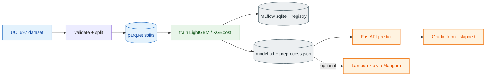
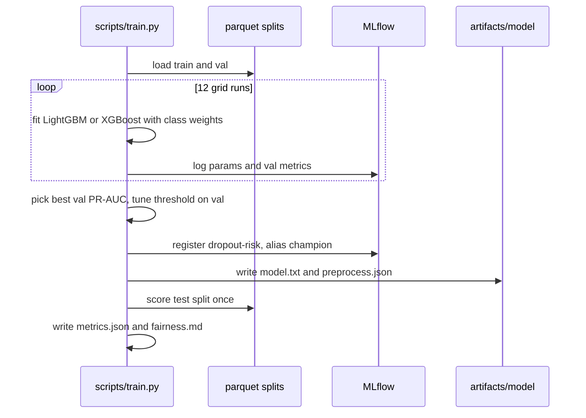
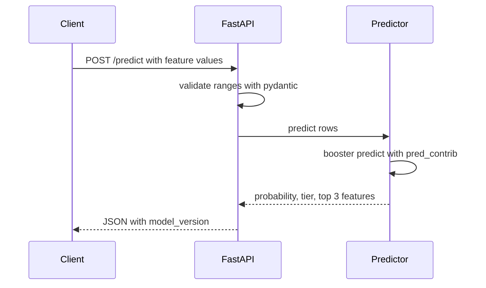
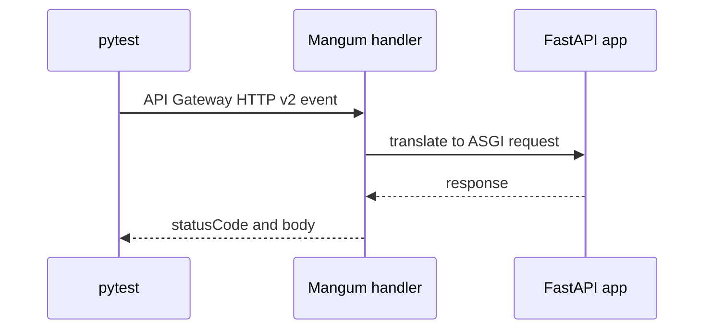
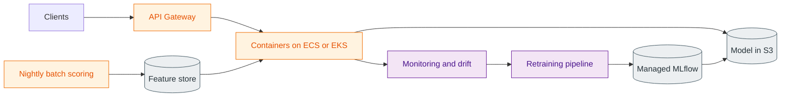

# P1 Student Dropout Risk — End-to-End ML Pipeline

     

Predict which students are likely to drop out, track every experiment in MLflow, and serve the model as a small local FastAPI service (with a local-only AWS Lambda package) — no Docker, no cloud account.

> [!WARNING]
> This is a **late-stage** model (all features are available only at the end of year 2), not an early-warning system. Read [Limitations & gotchas](#12-limitations--gotchas) before using any output about real people.

## 2. What you'll learn

| Concept | Where it shows up in this project |
|---|---|
| ML lifecycle | data → train → track → register → serve → package, one phase each |
| Data validation | `data.validate` fails loudly on schema, range and row-count errors |
| Leakage and prediction point | Decision D1: which features exist at prediction time |
| Stratified splits | 70/15/15 split stratified on the 3-class target, seed 42 |
| Class imbalance | class weighting (dropout base rate 0.321) |
| Gradient boosting | LightGBM (served) vs XGBoost (tracked comparison) |
| ROC-AUC vs PR-AUC vs recall | all reported; PR-AUC compared with the base rate |
| Threshold tuning | max recall at precision >= 0.6 on the validation split |
| Experiment tracking and registry | MLflow on SQLite, model `dropout-risk` alias `champion` |
| Model signature | logged with each MLflow run, plus an input example |
| SHAP-style explanations | LightGBM `pred_contrib=True` (exact TreeSHAP), top 3 per prediction |
| Fairness | metrics sliced by gender and age band |
| Serverless packaging | Mangum handler, aarch64 zip built without Docker |

## 3. Architecture



| Layer | Tool | Exact version | Responsibility |
|---|---|---|---|
| Data | ucimlrepo + pandas + pyarrow | 0.0.7 / 2.2.3 / 18.1.0 | fetch, validate, split, write parquet |
| Model | LightGBM (served), XGBoost (comparison) | 4.5.0 / 2.1.3 | train with class weights, tuned threshold |
| Tracking | MLflow (SQLite backend) | 2.19.0 | params, metrics, plots, signature, registry |
| Export | `model.txt` + `preprocess.json` | n/a | serving needs no pandas, sklearn or MLflow |
| Serving | FastAPI + uvicorn + pydantic | 0.115.6 / 0.32.1 / 2.10.3 | `/health`, `/predict`, `/predict/batch` |
| Packaging | Mangum | 0.19.0 | wrap the ASGI app as a Lambda handler (local only) |
| Runtime | Python (uv) | 3.11.11 (uv 0.5.11) | one venv, `.venv` |

## 4. Tech stack and why

| Choice | Why | Alternative not used |
|---|---|---|
| LightGBM | strong on small tabular data, built-in exact TreeSHAP via `pred_contrib` | `shap` package (extra dependency) |
| XGBoost | tracked as a comparison only | serving two model formats |
| MLflow + SQLite | registry and UI with no server to run | a hosted tracking server |
| FastAPI + pydantic | request schema generated from validated column ranges, so out-of-range input returns 422 | hand-written validation |
| Files + SQLite only | the whole project stays portable and small | a database server |
| No Docker | laptop-first (8 GB, `small` profile); the Lambda zip is built with `uv pip install --python-platform` instead | container image build |

> [!TIP]
> **Why no Docker here** — What: containers package an app with its OS libraries. Why not: they cost RAM and setup on an 8 GB laptop and this app is one small process. How we use it here: not at all; containers appear only in the scaling path (section 13).

## 5. Prerequisites

- macOS on Apple Silicon (primary, verified), or Windows 10/11 with VS Code + PowerShell, or Linux. 8 GB unified memory is enough (training peak footprint 424,494,688 B, see `reports/resources.md`).
- macOS: Xcode Command Line Tools (git), Homebrew with `brew install libomp` (LightGBM/XGBoost need it), `uv` 0.5.11. Windows: Python 3.11 (`py -3.11`) and git; no `libomp` step.
- Windows status: **verified on macOS only.** The Windows code paths in `run.py` (venv path, process stop) are covered by monkeypatched unit tests, not by a Windows run; please report issues.
- Network access for the first `make data` (the dataset is fetched live from UCI).
- Time: the fresh-build run measured about 39.6 s for `make data` and 18.1 s for `make train`.

## 6. Quickstart

**macOS / Linux**

```bash
cd p1-e2e-ml-pipeline-dropout
brew install libomp            # macOS only, once
python3 run.py setup           # venv + dependencies (uv, Python 3.11)
python3 run.py data            # fetch UCI 697, validate, split, write reports/eda.md
python3 run.py train           # 12 MLflow runs, register champion, export model
python3 run.py verify          # lint + tests + smoke (starts and stops the API)
python3 run.py serve           # API on http://127.0.0.1:8000  (docs at /docs)
python3 run.py ui              # Gradio form on http://127.0.0.1:7861
python3 run.py mlflow-ui       # MLflow UI on http://127.0.0.1:5001
```

`make <target>` does the same on macOS/Linux (`make setup data train verify serve ui mlflow-ui`).

**Windows (VS Code terminal, PowerShell)**

```powershell
cd p1-e2e-ml-pipeline-dropout
Set-ExecutionPolicy -Scope Process RemoteSigned      # lets .venv\Scripts\Activate.ps1 run
py -3.11 -m venv .venv
.venv\Scripts\Activate.ps1
python run.py setup            # installs requirements-dev.txt (uv if present, else pip)
python run.py data
python run.py train
python run.py verify
python run.py serve            # new terminal: python run.py ui ; python run.py mlflow-ui
```

`run.py` is stdlib-only and picks `.venv\Scripts\python.exe` on Windows (`.venv/bin/python` elsewhere), so activating the venv is optional. Optional Lambda zip: `python run.py package` (needs `uv`, local only).

## Inputs & Outputs

| Input | Where entered | Output | Where saved / shown |
|---|---|---|---|
| UCI dataset id 697 (network) | `python run.py data` | validated 70/15/15 splits, EDA | `data/processed/*.parquet` (gitignored), `reports/eda.md` |
| Processed splits, `configs/config.yaml` | `python run.py train` | 12 MLflow runs, champion, tuned threshold | `mlflow.db`, `artifacts/model/`, `reports/metrics.json`, `reports/fairness.md`, `reports/train_time.txt` |
| `reports/metrics.json` | `python run.py eval` | test metrics table | console |
| One student (all model features, JSON) | Swagger `POST /predict` at `/docs` | probability, risk tier, top-3 SHAP | HTTP response |
| 1..100 students | `POST /predict/batch` | list of the above | HTTP response |
| ~10 key features in a form (rest preset) | Gradio page, port 7861 | probability, tier, SHAP bar chart | browser |
| running API | `python run.py smoke` | 3 checks + 200 timed calls | console, `reports/latency.md` |

## Live demo script (about 10 minutes)

**Pre-demo checklist:** `python run.py demo` (checks the trained model exists and that ports 8000, 5001 and 7861 are free, then runs `eval` and `smoke`). Models here are trained locally, nothing is downloaded at demo time, so `HF_HUB_OFFLINE` does not matter for p1.

| # | Do | Say | Expect |
|---|---|---|---|
| 1 | `python run.py eval` | Late-stage model; threshold tuned for recall at precision >= 0.6. | Threshold table and test metrics (values in section 11). |
| 2 | `python run.py mlflow-ui`, open http://127.0.0.1:5001 | Every training run is tracked; the champion is a registered model alias. | Experiment `dropout-risk` with 12 runs; model `dropout-risk`, alias `champion`. |
| 3 | `python run.py serve`, open http://127.0.0.1:8000/docs | Typed, validated API; the example body is pre-filled. | `POST /predict` -> Try it out -> Execute: high tier, three SHAP contributions. |
| 4 | Same page: change `debtor` to `7` | Out-of-range input is rejected. | HTTP 422. |
| 5 | `python run.py ui`, open http://127.0.0.1:7861 | Same model, friendly form. | Click the examples below. |

UI examples (inputs are preset, outputs come from the trained model):

| Example | Key inputs | Output seen in the last verification run |
|---|---|---|
| Low-risk student | 6 of 6 units approved per semester, grade 14 | LOW, P(dropout) 6.1% |
| Medium-risk student | 5 of 6 approved, grade 12 | MEDIUM, 15.0% |
| High-risk student | 1 then 0 units approved, debtor, fees not paid | HIGH, 99.3% |

Finish with `python run.py stop` to end anything recorded in `.run/*.pid`.

## 7. Build from scratch

### Phase 1 — Data
- **Goal:** a validated, reproducible 70/15/15 split.
- **Concept:** validation, stratification, leakage.

> [!TIP]
> **Stratified split** — What: each split keeps the class proportions of the whole dataset. Why: with 32% dropouts a random split could skew evaluation. How we use it here: stratified on the 3-class target with seed 42, and a binary `dropout` column is added to every split.

- **Commands:** `python run.py data`
- **Files:** `src/dropout_risk/data.py`, `scripts/make_data.py`, `scripts/eda.py`
- **Expected output:** splits of 3096 + 664 + 664 = 4424 rows; `reports/eda.md` (zero missing cells; dropout rate 0.321 in train and val, 0.322 in test).
- **Checkpoint:** counts sum to 4,424 and `reports/eda.md` exists.

### Phase 2 — Train, track, fairness
- **Goal:** pick a champion, tune the threshold, register and export it.
- **Concept:** class imbalance, PR-AUC, threshold tuning, registry, signature.

> [!TIP]
> **Threshold tuning** — What: choosing the probability cut-off that turns a score into a flag. Why: 0.5 is arbitrary on imbalanced data. How we use it here: on the validation split, take the highest recall subject to precision >= 0.6 (fallback to best F1 if infeasible; no fallback was needed).

- **Commands:** `python run.py train`, then `python run.py mlflow-ui`
- **Files:** `src/dropout_risk/train.py`, `features.py`, `fairness.py`, `scripts/train.py`
- **Expected output:** 12 runs (8 LightGBM + 4 XGBoost); `dropout-risk` with a new registry version and alias `champion`; `artifacts/model/model.txt`, `artifacts/model/preprocess.json`, `reports/metrics.json`, `reports/fairness.md`, confusion matrix and feature-importance PNGs.
- **Checkpoint:** test PR-AUC 0.903 is well above the 0.322 base rate.

### Phase 3 — Serve
- **Goal:** a typed HTTP API with explanations.
- **Concept:** schema-driven validation, TreeSHAP contributions.
- **Commands:** `python run.py serve`, `python run.py ui` or `python run.py smoke`
- **Files:** `src/dropout_risk/api.py`, `schemas.py`, `predict.py`, `ui_core.py`, `scripts/ui.py`
- **Expected output:** `/health` 200, `/predict` returns probability, `risk_tier`, top 3 contributing features and `model_version`; out-of-range input and batches over 100 rows return 422.
- **Checkpoint:** `make smoke` passes; `reports/latency.md` written.

### Phase 4 — Lambda (local only, D4)
- **Goal:** prove the model can be packaged for AWS Lambda without deploying.
- **Concept:** serverless packaging with Mangum.
- **Commands:** `python run.py package` (optional)
- **Files:** `src/dropout_risk/lambda_handler.py`, `requirements-lambda.txt`, `scripts/build_lambda.py`, `tests/events/predict.json`
- **Expected output:** 185 MB unzipped (limit 250 MB), zip 52.7 MB. The handler is tested in-process with an API Gateway HTTP v2 event (200 on a valid prediction, 422 on bad input, health check).
- **Checkpoint:** the in-process handler test passes. No AWS deploy was done and `boto3` is not installed.

### Phase 5 — Verify and document
- **Goal:** prove a fresh build reproduces the results.
- **Commands:** `python run.py verify` or `make verify` (lint + test + smoke)
- **Expected output:** lint OK, 35 tests passed, smoke OK; a fresh build in a throwaway copy reproduced `metrics.json` exactly except the MLflow run id (`reports/verification.md`).

## 8. Key workflows

### Training and registration



### Inference



### Local Lambda test



## 9. Configuration reference

`configs/config.yaml` (no hardcoded paths in code):

| Key | Value | Meaning |
|---|---|---|
| `seed` | 42 | used everywhere |
| `profile` | small | `small` n_jobs 2 (default), `standard` n_jobs 4 |
| `data.uci_id` | 697 | UCI dataset id |
| `data.split` | 0.70 / 0.15 / 0.15 | train / val / test |
| `model.target_mode` | binary | Dropout vs rest (D2) |
| `model.threshold_min_precision` | 0.6 | precision floor for threshold tuning |
| `model.max_grid_runs` | 12 | grid size cap |
| `mlflow.tracking_uri` | `sqlite:///mlflow.db` | resolved against the project root |
| `mlflow.model_name` / `alias` | dropout-risk / champion | registry entry |
| `api.port` / `api.max_batch` | 8000 / 100 | serving |
| `ui.port` | 7861 | Gradio form |

Environment (`.env.example`): `P1_PROFILE=small`, `HF_HUB_OFFLINE`, `TOKENIZERS_PARALLELISM`, `PYTORCH_ENABLE_MPS_FALLBACK` (the last three are shared repo defaults and are unused by this project). Lambda reads `P1_MODEL_DIR` (default `artifacts/model`).

## 10. Testing and verification

- `python run.py lint` (ruff), `test` (pytest), `smoke` (real uvicorn plus real requests), `verify` runs all three (`make <target>` is equivalent on macOS/Linux).
- Last verified run (macOS): 35 tests passed, smoke OK. Windows: `run.py` logic covered by monkeypatched tests only; no Windows run was done.
- Tests cover validation, stratification, leakage, threshold choice, the API (a tiny in-test booster, no dependency on `artifacts/`) and the Lambda handler.
- Verified serve flow: `/health` 200, `/predict` 200, `/predict/batch` 200, out-of-range 422, empty body 422, batch of 102 rows 422.
- A fresh build in a throwaway copy reproduced `metrics.json` (details in `reports/verification.md`).

## 11. Results

All numbers come from `reports/metrics.json`, `fairness.md`, `latency.md` and `resources.md`.

**Champion:** LightGBM, `num_leaves` 15, `learning_rate` 0.03, `n_estimators` 400 (best validation PR-AUC). Threshold 0.227 (rule: max recall at precision >= 0.6, no fallback).

| Split | ROC-AUC | PR-AUC | F1 | Recall | Precision | Base rate |
|---|---|---|---|---|---|---|
| Validation | 0.899 | 0.844 | 0.707 | 0.859 | 0.600 | 0.321 |
| Test | 0.928 | 0.903 | 0.747 | 0.883 | 0.647 | 0.322 |

The best XGBoost run reached validation PR-AUC 0.843 (`max_depth` 3, `learning_rate` 0.1) against LightGBM's 0.844, so the two are very close.

**Fairness slices (test split, threshold 0.227, groups with n < 30 suppressed):**

| Slice | Group | n | Dropout rate | Flag rate | Recall | Precision |
|---|---|---|---|---|---|---|
| gender | female | 420 | 0.233 | 0.350 | 0.857 | 0.571 |
| gender | male | 244 | 0.475 | 0.594 | 0.905 | 0.724 |
| age band | <20 | 272 | 0.191 | 0.368 | 0.885 | 0.460 |
| age band | 20-24 | 212 | 0.274 | 0.392 | 0.828 | 0.578 |
| age band | 25-29 | 78 | 0.615 | 0.628 | 0.875 | 0.857 |
| age band | 30+ | 102 | 0.549 | 0.588 | 0.946 | 0.883 |

**Latency** (single `/predict`, local uvicorn, 200 sequential requests): p50 2.17 ms, p95 4.96 ms, max 14.28 ms (latest run, `reports/latency.md`; other jobs were running on the machine).

**Resources:**

| Step | Wall time | Max RSS | Peak footprint |
|---|---|---|---|
| make data (fresh copy, incl. UCI fetch) | 39.6 s | not measured | not measured |
| make train (earlier real p1 run, `/usr/bin/time -l`) | 11.05 s | 500,252,672 B | 424,494,688 B |
| `run.py train` (latest, Python-measured) | 8.55 s | 480,788,480 B | not recorded |
| make train (fresh copy) | 18.11 s | 510,361,600 B | not recorded |
| API serve RAM | not measured | - | - |

**Lambda package:** 185 MB unzipped, 52.7 MB zip.

## 12. Limitations & gotchas

> [!WARNING]
> **Late-stage prediction point (D1).** The model uses all features, including curricular-unit grades and approvals for both semesters, which exist only at the end of year 2. It identifies students who already look like dropouts; it is **not** an early-warning system. The strongest correlates in `reports/eda.md` (2nd-semester grade r = -0.572, 2nd-semester approved r = -0.570) are exactly these late features. Building an early-warning model would need a different, earlier feature set and would likely score lower.

> [!WARNING]
> **Fairness gap flagged in verification.** On the test split the model flags 59.4% of male students versus 35.0% of female students. Part of this is a real base-rate difference (dropout rate 0.475 vs 0.233), but recall and precision also differ (male 0.905 / 0.724, female 0.857 / 0.571), and for the under-20 band precision is only 0.460 (many false alarms). Sensitive attributes are excluded from the model (D3: gender, age at enrollment, nationality, international, marital status, special needs), yet other features can act as proxies. This is acknowledged, not fixed; no mitigation (per-group thresholds, reweighting) was tried.

- **The Gradio form loads the model in-process.** `python run.py ui` (port 7861) does not call the API; it is a demo surface, and the form shows ~10 features while the rest keep a preset value.
- **Lambda is local only (D4).** Nothing was deployed, `boto3` is not installed and there are no deploy or teardown scripts. The handler is tested in-process with the macOS LightGBM build, so that test checks logic, not the Linux import.
- **libgomp is unverified.** The aarch64 `lib_lightgbm.so` needs `libgomp.so.1`, `libstdc++.so.6` and `libgcc_s.so.1`, none bundled in the wheel. It cannot be loaded on macOS and there is no Docker here, so whether the Lambda python3.11 runtime provides `libgomp.so.1` is **unverified**. Mitigation if the import fails on a first real deploy: copy an aarch64 libgomp into `lib/libgomp.so.1` inside the zip.
- **The zip needs S3.** At 52.7 MB the zip exceeds the 50 MB direct-upload limit, so a real deploy must go through S3 (the 250 MB unzipped limit still applies; 185 MB measured).
- **Data is fetched live, with no checksum.** `make data` pulls UCI dataset 697 over the network with `ucimlrepo`. There is no pinned snapshot or checksum, so upstream changes would go unnoticed except through the row-count, schema and range checks. License: **CC BY 4.0**; credit the dataset authors (see References) if you redistribute anything derived from it.
- **Ethics of labelling students.** A "high risk" label can become self-fulfilling, stigmatise a student, or be used to deny support rather than offer it. Use scores only to prioritise outreach by a human, never for automated decisions, keep a person in the loop, tell students how data is used, and re-check fairness before any use.
- **Single-institution data.** The data comes from one Portuguese higher-education institution; results may not transfer elsewhere.
- **Correlation is not causation.** Feature contributions explain the model, not why students leave.
- **Serving supports LightGBM only.** XGBoost is a tracked comparison and is not exported.
- **Open measurement gap.** API RAM was not measured. `reports/train_time.txt` contains log noise from MLflow and Alembic before the timing block.
- **Repo hygiene.** Small run artifacts (`mlflow.db`, `build/`, `*.zip`) are gitignored.

## 13. Scaling 100 → 10K → 1M users

| Users | Architecture | Cost drivers |
|---|---|---|
| 100 | one Lambda with a Function URL (or this local FastAPI process) | near zero; free tier |
| 10K | API Gateway, provisioned concurrency, model in S3, CloudWatch | provisioned concurrency, logging volume |
| 1M | containers (ECS/EKS), nightly batch scoring, feature store, managed MLflow, CI/CD retraining with drift trigger | compute, feature store, retraining, monitoring |



Containers and cloud belong here as the scaling path, not in the local build. These tiers are design guidance and were not load-tested.

## 14. Troubleshooting

- **LightGBM or XGBoost import error mentioning `libomp`** — run `brew install libomp`.
- **`import mlflow` fails with a SQLAlchemy error** — `requirements.txt` pins `sqlalchemy==2.0.36`; uv otherwise resolved 2.1.4, which breaks MLflow 2.19.0.
- **Windows: `Activate.ps1` cannot be loaded** — run `Set-ExecutionPolicy -Scope Process RemoteSigned` in the same terminal, or skip activation (`python run.py ...` finds `.venv\Scripts\python.exe` itself).
- **Windows: port already in use** — `netstat -ano | findstr :8000`, then `taskkill /PID <pid> /F`; or `python run.py stop`.
- **Windows: long path errors on install** — clone close to the drive root or enable long paths (`git config --system core.longpaths true` and the Windows LongPathsEnabled policy).
- **Windows: CPU vs CUDA** — p1 is CPU-only (LightGBM/XGBoost); no GPU or CUDA setup is needed.
- **Port 5000 busy** — macOS AirPlay Receiver owns it; MLflow UI uses 5001.
- **Port 8000 busy after a failed smoke** — `python run.py stop` (or `make stop`) kills anything recorded in `.run/*.pid`.
- **`uv` rejects `aarch64-manylinux2014`** — uv 0.5.11 needs the equivalent `aarch64-manylinux_2_17` (already used in `scripts/build_lambda.py`).
- **`make data` fails offline** — the UCI fetch needs network access.
- **Validation error on data load** — the upstream data changed; inspect the failing schema or range check before loosening it.

## 15. Exercises / next steps

1. Switch `model.target_mode` to 3-class and compare what changes in metrics and thresholds.
2. Retrain without the 2nd-semester features and measure the PR-AUC drop for a more early-warning-like model.
3. Add a per-group threshold or reweighting and re-read `reports/fairness.md`.
4. Add a checksum or a pinned snapshot of the UCI data.
5. Measure API RAM and add it to `reports/resources.md`.
6. Make the Gradio form call the running API instead of loading the model in-process.
7. Verify libgomp in a real Lambda arm64 environment and deploy through S3.

## 16. References and licenses

- Dataset: UCI "Predict Students' Dropout and Academic Success" (id 697), 4,424 rows, 36 features, **CC BY 4.0**. Please cite the dataset authors as listed on its UCI page.
- Model: trained here with LightGBM 4.5.0 (MIT) and XGBoost 2.1.3 (Apache 2.0); no pretrained or third-party models are used.
- Tools: MLflow, FastAPI, pydantic, Mangum, pandas, scikit-learn, uv (see their respective licenses).
- Project records: `PLAN.md`, `DECISIONS.md`, `reports/verification.md`.
