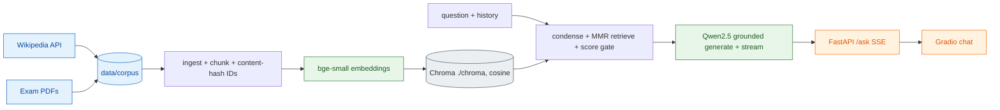

# P2 Study Assistant — Plan

## Goal
Local RAG chatbot that answers ONLY from course notes (Wikipedia) and past exam papers, with
`[source:page]` citations, and refuses when the answer is not in the sources.

## Architecture

## Components (dry-run resolved on Python 3.11 arm64, see DECISIONS.md for the pin change)
| Component | Version |
|---|---|
| torch / transformers / accelerate | 2.5.1 / **4.46.3** (spec: 4.47.1, conflicts with chromadb) / 1.2.1 |
| sentence-transformers / huggingface-hub | 3.3.1 / 0.27.0 |
| langchain / langchain-huggingface / langchain-chroma | 0.3.13 / 0.1.2 / 0.1.4 |
| chromadb / pypdf | 0.5.23 / 5.1.0 |
| fastapi / uvicorn / gradio | 0.115.6 / 0.32.1 / 5.9.1 |
| Embeddings | BAAI/bge-small-en-v1.5 (MIT), rev 5c38ec7c405ec4b44b94cc5a9bb96e735b38267a |
| LLM default / fallback | Qwen2.5-1.5B-Instruct rev 989aa798… / Qwen2.5-0.5B-Instruct rev 7ae55760… (Apache-2.0) |

## Phases and acceptance
0b Models — download_models.py with pinned revisions; then HF_HUB_OFFLINE=1.
1 Ingest — loaders, notes 800/120, exam per-question regex + fallback (fallback rate reported), idempotent IDs. Accept: reports/ingest.md; re-run adds 0.
2 Index — Chroma cosine, bge query instruction prefix, probe.md for 3 queries.
3 RAG chain — optional condense (skipped without history), MMR k=4 fetch_k=12, token-budget truncation, retrieval-score refusal gate, streaming in a thread. Accept: 3 in-corpus cited, 2 out-of-corpus refused.
4 API + UI — one process owns both models (FastAPI lifespan, workers=1, concurrency 1); /ingest in threadpool with lock; /ask SSE with sources event; Gradio consumes the API.
5 Eval — 20+ questions incl. ≥5 unanswerable, drafted from real chunks and auto-drafted, not human-reviewed (see DECISIONS.md); recall@4, MRR, citation rate (resolves to retrieved chunk), refusal accuracy → reports/eval.json (indicative only).
6 /verify then /readme.

## Budget (small profile, 8 GB)
Qwen 1.5B fp16 ≈ 3.1 GB + bge-small 0.13 GB + torch/MPS/Chroma/Gradio/FastAPI ≈ 1.5–2.5 GB, all in ONE process. Fallback: Qwen 0.5B. Peak RAM + wall time recorded in reports/resources.md.

## Risks and mitigations
- Pin conflict transformers 4.47.1 vs chromadb 0.5.23 (tokenizers) → transformers 4.46.3 (approved, see DECISIONS.md).
- 1.5B model unreliable at refusing → retrieval-score gate tuned on eval, fixed refusal phrase.
- Exam PDF layout/regex fragility, no OCR → fixture tests, fallback-rate metric.
- Eval leakage (questions from chunks) → user paraphrase, unanswerable set, "indicative" caveat.
- Licenses: Wikipedia CC BY-SA (store title/URL/revision; data/ and chroma/ gitignored); exam PDFs verified per URL and logged; never commit PDFs.
- Chroma telemetry off; one worker only (persistence locking); retrieved text treated as untrusted (prompt-injection note).
