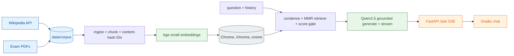
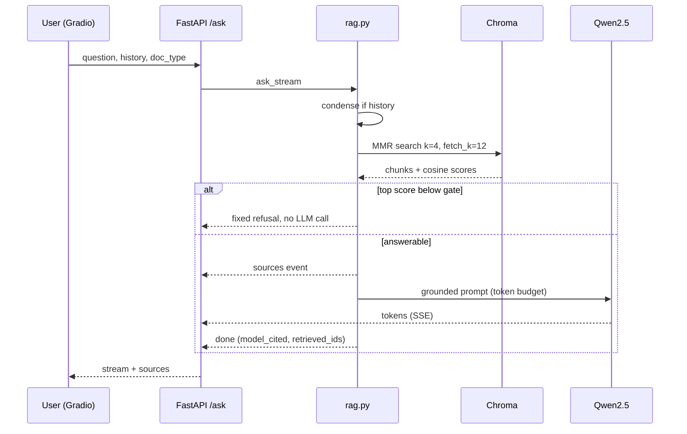
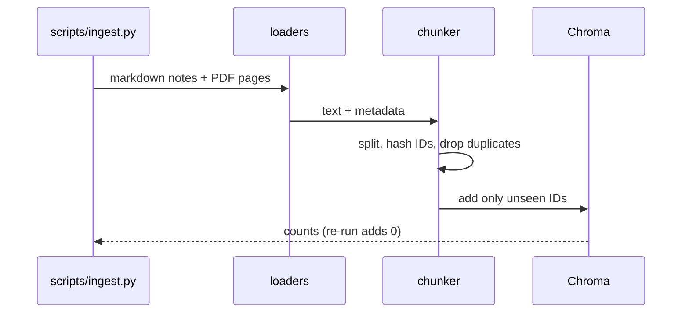
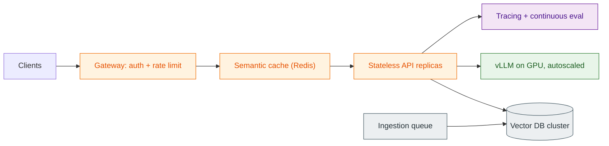

# P2 Study Assistant — local RAG chatbot over notes and past exams

    

A chatbot that answers ONLY from your course notes and past exam papers, shows its sources, and refuses when the answer is not there. Fully local: no Docker, no API keys, no model server.

## 1. What you'll learn

| Concept | Where |
|---|---|
| Why RAG (vs fine-tuning) | Section 4 |
| Document loading, chunking, structure-aware exam chunking | `ingest.py` |
| Embeddings, vector DB, similarity search | `index.py` |
| MMR, metadata filtering | `rag.py`, `index.py` |
| Prompt grounding, hallucination, refusal gate | `rag.py` |
| Conversational memory (question condensing) | `rag.py` |
| Streaming (SSE, `TextIteratorStreamer`) | `llm.py`, `api.py` |
| RAG evaluation | `scripts/run_eval.py` |

## 2. Architecture



| Layer | Tool | Exact version | Responsibility |
|---|---|---|---|
| Corpus | MediaWiki API, pypdf | pypdf 5.1.0 | 20 Wikipedia notes + 2 MIT OCW exam PDFs |
| Chunking / retrieval glue | LangChain | langchain 0.3.13, langchain-huggingface 0.1.2, langchain-chroma 0.1.4 | splitting, embeddings wrapper |
| Embeddings | BAAI/bge-small-en-v1.5 | rev 5c38ec7c (MIT) | 384-dim, normalized, query instruction prefix |
| Vector DB | Chroma embedded | chromadb 0.5.23 | cosine index persisted to `p2-rag-chatbot-study/chroma` |
| LLM | Qwen2.5-1.5B-Instruct (fallback 0.5B) | rev 989aa798 (Apache-2.0), transformers 4.46.3, torch 2.5.1 | in-process, MPS fp16, streaming |
| API | FastAPI + uvicorn | 0.115.6 / 0.32.1 | `/health`, `/ask` (SSE), `/ask/simple` (JSON), `/ingest` |
| Console | rich | 13.9.4 | narrated scripts (plain-print fallback, honors `NO_COLOR`) |
| UI | Gradio | 5.9.1 | chat + doc_type filter, HTTP client of the API |

## 3. Tech stack: why these

- **Chroma embedded** over Qdrant/Weaviate: no server, one folder, enough for ~2.7K chunks.
- **transformers in-process** over Ollama: one process, pinned revisions, offline (`HF_HUB_OFFLINE=1`).
- **LangChain only for splitting/embeddings/retrieval**; generation uses our own `llm.py` so streaming stays simple.
- **No Docker**: an 8 GB laptop cannot afford a VM layer plus a model; containers appear in the scaling path (section 13).

## 4. Prerequisites

macOS on Apple Silicon (primary, verified), or Windows 10/11 / Linux (CPU or CUDA; see the verification note in Quickstart). Baseline 8 GB memory (`small` profile), Python 3.11 (via `uv` 0.5.11 or `py -3.11`); Xcode CLT on macOS. Measured footprint: Chroma index 18 MB; API RSS about 807 MB after one ask (sampled, not true peak); `make index` peak RAM 966 MB. First run needs network once to download models and corpus.

> [!TIP]
> **RAG vs fine-tuning** — What: retrieve relevant text at question time and put it in the prompt. Why: notes change, citations are possible, and no training is needed. How we use it here: bge-small retrieves 4 chunks, Qwen answers only from them.

## 5. Quickstart

> [!NOTE]
> **Verification status:** verified on macOS (Apple Silicon). There was no Windows machine available: the Windows code paths in `run.py` (venv path, `taskkill`) and the cuda > mps > cpu device order are covered by monkeypatched unit tests only. Please report Windows issues. On Windows expect CPU-speed generation (slower than MPS/CUDA).

All commands use the cross-platform runner `run.py` (stdlib only); `make <target>` still works on macOS/Linux.

**macOS / Linux**

```bash
cd p2-rag-chatbot-study
uv venv --python 3.11 .venv && uv pip install --python .venv/bin/python -r requirements-dev.txt   # or: python3 run.py setup
.venv/bin/python run.py models      # pinned model revisions (network, once)
.venv/bin/python run.py data        # fetch corpus into data/corpus
.venv/bin/python run.py index       # chunk + embed into Chroma + probe 3 queries (ingest step included)
.venv/bin/python run.py serve       # API on :8000   (P2_API_PORT overrides)
.venv/bin/python run.py ui          # Gradio on :7860 (second terminal; P2_UI_PORT overrides)
.venv/bin/python run.py verify      # lint + tests + smoke
```

**Windows (VS Code, PowerShell)**

```powershell
cd p2-rag-chatbot-study
py -3.11 -m venv .venv
Set-ExecutionPolicy -Scope Process RemoteSigned   # only if Activate.ps1 is blocked
.venv\Scripts\Activate.ps1
python -m pip install -r requirements-dev.txt     # no brew/libomp needed on Windows
python run.py models
python run.py data
python run.py index
python run.py serve                                # terminal 1: API on :8000
python run.py ui                                   # terminal 2: Gradio on :7860
python run.py verify
```

`python run.py` lists all subcommands (`setup data models ingest index eval serve ui demo smoke test lint verify stop clean`). After models are downloaded, `run.py` runs children with `HF_HUB_OFFLINE=1` automatically (except `models`/`data`).

## 5b. Inputs and outputs

| Input | Where entered | Output | Where saved / shown |
|---|---|---|---|
| Wikipedia titles + exam URLs | `configs/config.yaml` | notes + PDFs | `data/corpus/` |
| Corpus | `run.py ingest` | chunk counts, fallback rate | console, `reports/ingest.md` |
| Chunks | `run.py index` | Chroma index + top-4 probe tables | `chroma/`, `reports/probe.md` |
| Question (+ doc filter) | Gradio chat, `POST /ask`, `POST /ask/simple` | answer, sources, refusal flag, gate score | UI / HTTP response |
| `eval/qa.jsonl` | `run.py eval` | recall@4, MRR, refusal accuracy | console, `reports/eval.{json,md}` |
| 3 in + 2 out-of-corpus questions | `run.py demo` | per-query gate score, outcome, citations | console, `reports/rag_demo.md` |

## 5c. Live demo script (about 10 minutes)

Pre-demo checklist: models downloaded (`python run.py models` once), `HF_HUB_OFFLINE=1` (set automatically by `run.py`), ports 8000 and 7860 free (`netstat -ano | findstr :8000` on Windows, `lsof -i :8000` on macOS), index built (`python run.py index` prints chunks in index).

1. **Retrieval** — `python run.py index`. Say: "chunks are embedded once; re-runs add 0". Expect: three probe tables with similarity roughly 0.78-0.89 (see `reports/probe.md`).
2. **Refusal gate in the terminal** — `python run.py demo`. Say: "below the threshold the LLM is never called". Expect: in-corpus questions answered with citations; the two out-of-corpus questions (World Cup, cookies) show gate score about 0.50-0.52 vs threshold 0.69 and REFUSED.
3. **Start the stack** — `python run.py serve`, then `python run.py ui` in a second terminal. Expect the API log to show models loading, then `/health` -> `{"status": "ok"}`.
4. **Gradio chat** — open http://127.0.0.1:7860 and click the examples: "What is the bias-variance tradeoff?" (answer + Sources), "How does gradient descent update model parameters?" with filter *notes*, then "Who won the 1998 football world cup?" (refusal `This is not in your notes.`). Open the Sources section to show the cited chunks.
5. **Swagger** — open http://127.0.0.1:8000/docs, run `POST /ask/simple` with the pre-filled example: JSON with `answer`, `refused`, `top_score`, `citations`, `sources`. `POST /ask` is the SSE variant used by the UI (Swagger cannot render streams).
6. **Eval (optional, a few minutes)** — `python run.py eval`; discuss the caveats in section 12 before quoting any number.
7. **Stop** — Ctrl+C in both terminals (or `python run.py stop`).

## 6. Build from scratch (one step per phase)

### Phase 0/0b — Plan, scaffold, models
Goal: reproducible env. Pin models by revision in `configs/config.yaml`, then run offline. Checkpoint: models load with `HF_HUB_OFFLINE=1`.

### Phase 1 — Ingest
> [!TIP]
> **Chunking** — What: split documents into retrievable pieces. Why: embeddings and prompts have size limits and precision drops with long text. How: notes use `RecursiveCharacterTextSplitter(800, 120)`; exams are split per question by regex (`Question/Problem/Q N`, `N.`, `N)`) with a recursive fallback. Chunk IDs are content hashes, so re-ingest is idempotent.

Files: `ingest.py`, `scripts/fetch_corpus.py`. Output: `reports/ingest.md` — 2745 chunks (20 notes docs, 2 exam docs), exam question chunks 21, fallback chunks 28, fallback rate 0.571, chunk length median 613 chars, re-run adds 0 new IDs. Checkpoint: re-run adds 0.

### Phase 2 — Index
> [!TIP]
> **Embeddings and vector DB** — What: text becomes a vector; similar meaning means close vectors. Why: finds paraphrases keyword search misses. How: bge-small (normalized, cosine) with the bge query instruction prefix; Chroma stores vectors plus metadata `{source, page, doc_type, year}`.

Output: `reports/probe.md`; top-4 relevant for bias-variance, gradient descent and SVM queries, similarity 0.78–0.89.

### Phase 3 — RAG chain
> [!TIP]
> **MMR and the refusal gate** — What: MMR re-ranks candidates to reduce near-duplicates (k=4 from fetch_k=12). The gate refuses without calling the LLM when the best cosine score is below the threshold (0.69). Why: a 1.5B model is unreliable at saying "no". How: `rag.py` retrieves, gates, truncates to a token budget, then streams a grounded answer.

Optional condensing rewrites follow-up questions using history (skipped when there is no history). Output: `reports/rag_demo.md` — 3 in-corpus questions answered (top sim 0.81–0.89), 2 out-of-corpus refused (top sim 0.50–0.52, no LLM call).

### Phase 4 — API + UI
One process owns both models (FastAPI lifespan, `workers=1`, concurrency 1). `/ask` streams SSE events `sources`, `token`, `done`, `error`; `/ingest` runs in a threadpool behind a lock (409 if busy). Gradio is a pure HTTP client. `POST /ask/simple` returns the same pipeline as one JSON object for Swagger demos. Checkpoint: `python run.py smoke` (1 in-corpus answered with sources via `/ask`, 1 out-of-corpus refused via `/ask/simple`).

### Phase 5 — Eval
`eval/qa.jsonl`: 31 questions with gold chunk IDs (see section 11 and the caveats in section 12). Run `make eval`.

### Phase 6 — Verify + README
Fresh-copy checks and an architect review; findings in `reports/verification.md`.

## 7. Key workflows





## 8. Configuration reference (`configs/config.yaml`)

| Key | Value |
|---|---|
| `seed` | 42 |
| `profile` | `small` (max_concurrent 1) / `standard` (2) |
| `chunking.notes` | size 800, overlap 120 |
| `retrieval` | k 4, fetch_k 12, mmr true, score_threshold 0.64 |
| `generation` | max_new_tokens 400, temperature 0.0, context_budget_tokens 3000, history_turns 3 |
| `models.*` | name + pinned revision (embedding, llm, llm_fallback) |
| `api.port` / `ui.port` | 8000 / 7860 (env overrides `P2_API_PORT`, `P2_UI_PORT`) |

`.env.example`: `PYTORCH_ENABLE_MPS_FALLBACK=1`, `TOKENIZERS_PARALLELISM=false`, `HF_HUB_OFFLINE` (set 1 after download), `ANONYMIZED_TELEMETRY=False`, `P2_PROFILE=small`.

## 9. Runner commands and make targets

`python run.py <cmd>` (cross-platform) mirrors `make <target>`: `setup data models ingest index eval serve ui demo test lint smoke verify stop clean`; `train` and `mlflow-ui` print "not used in this project". `stop` kills PIDs in `.run/` (`taskkill` on Windows). `index` now includes the ingest step.

## 10. Testing and verification

`python run.py verify` (= `make verify`) = ruff + 30 pytest tests (tiny fixtures, no network; includes monkeypatched Windows path, console fallback and `/ask/simple` tests) + smoke (real uvicorn, 1 in-corpus question answered with sources, 1 out-of-corpus refused). Earlier full verify timing is in `reports/verification.md`. A fresh copy installed and tested (lint clean, tests passed at the time) without rebuilding models, corpus or Chroma.

## 11. Results (real runs, `reports/eval.json`; indicative only, see section 12)

| Metric | Value |
|---|---|
| Questions (answerable / unanswerable) | 31 (24 / 7) |
| recall@4 | 0.792 |
| MRR | 0.719 |
| Model-emitted citation rate | 0.083 |
| Citation resolve rate | 1.0 |
| Sources-fallback rate | 0.917 |
| Refusal accuracy (unanswerable) | 1.0 (7/7) |
| Answer rate (answerable) | 1.0 (24/24) |
| Gate accuracy at 0.65 and 0.69 | 1.0 and 1.0 |
| Max top score unanswerable / min top score answerable | 0.604 / 0.773 |

Resources (`reports/resources.md`): API startup to healthy about 10 s; one in-corpus `/ask` 6.1 s; `make index` about 30 s.

## 12. Limitations and gotchas

- **Model-emitted citation rate is 0.083.** Qwen 1.5B mostly ignores inline-citation instructions, so answers rely on the pipeline appending a `Sources:` line from retrieved chunks (fallback rate 0.917). Those sources show what was retrieved, not proof the model used each one.
- **Eval is indicative, not a benchmark.** The 31 questions were auto-drafted from indexed chunks and NOT human-reviewed; n is small. The refusal gate (0.64) was tuned on the same set, so 100% refusal accuracy is in-sample.
- **Exam chunk fallback rate is 0.571.** Most exam content (figure and solution pages) lacks question markers and falls back to recursive splitting. Very short chunks exist (min 3 chars); a min-length filter is not yet implemented.
- **Small-model reasoning.** Qwen 1.5B can paraphrase badly or miss multi-chunk synthesis; recall@4 is 0.792, so some answerable questions lack the gold chunk.
- **No OCR, English only.** Scanned PDFs, tables and equations are poorly extracted.
- **Licenses.** Wikipedia notes are CC BY-SA (title, URL and revision are stored in front matter); MIT OCW 6.867 exams are CC BY-NC-SA 4.0, non-commercial use only. The corpus is NOT committed (`data/`, `chroma/` are gitignored); rebuild it with `make data`.
- **transformers pinned to 4.46.3** (not the repo-wide 4.47.1) because 4.47.1 needs tokenizers>=0.21 while chromadb 0.5.23 needs <=0.20.3.
- Retrieved text is untrusted (prompt-injection risk); one worker only (Chroma persistence locking); one request at a time.

## 13. Scaling 100 → 10K → 1M users

| Users | Change |
|---|---|
| 100 | This build: one process, embedded Chroma, one model, concurrency 1 (queue requests) |
| 10K | Client/server vector DB (Qdrant/Weaviate) or managed (Pinecone serverless); async ingestion queue; Redis semantic cache; separate API and model services |
| 1M | Containers + GPU serving (vLLM), autoscaling, multi-tenant namespaces, auth + rate limits, tracing (OpenTelemetry/Langfuse), continuous eval |



Cost drivers: GPU hours for generation, vector DB memory, embedding throughput on ingest, cache hit rate.

## 14. Troubleshooting

**Windows first**

| Symptom | Fix |
|---|---|
| `Activate.ps1` is blocked | `Set-ExecutionPolicy -Scope Process RemoteSigned` (this session only) |
| Port 8000/7860 in use | `netstat -ano \| findstr :8000`, then `taskkill /PID <pid> /F`; or set `P2_API_PORT` / `P2_UI_PORT` |
| Path too long during install/download | Enable long paths (`LongPathsEnabled`) or clone to a short path such as `C:\src\p2` |
| Very slow answers | CPU-only torch; a CUDA build of torch is optional and not installed here. Use `llm_fallback` (0.5B) if needed |

**macOS**

| Symptom | Fix |
|---|---|
| Port 5000 busy | AirPlay Receiver; this project uses 8000 and 7860 |
| Offline load fails with missing 'main' ref | Revisions are passed explicitly; re-run `download_models.py` |
| pip conflict on tokenizers | Keep `transformers==4.46.3` |
| MPS op not implemented | `PYTORCH_ENABLE_MPS_FALLBACK=1` |
| Out of memory | Switch to `llm_fallback` (Qwen2.5-0.5B) in config |
| `/ingest` returns 409 | An ingest is already running |
| Stray servers | `python run.py stop` (or `make stop`) |

## 15. Exercises / next steps

1. Human-review `eval/qa.jsonl`, add held-out questions, and re-tune the gate on a separate split.
2. Add a few-shot citation example or try a larger model (needs approval) and compare citation rate.
3. Add a min-length chunk filter and re-index; compare recall@4.
4. Improve exam chunking for figure/solution pages and track the fallback rate.
5. Add a reranker and compare MRR.

## 16. References and licenses

- Wikipedia articles: CC BY-SA (title, URL, revision in each note's front matter).
- MIT OCW 6.867 Machine Learning finals 2003 and 2004: CC BY-NC-SA 4.0, © MIT.
- BAAI/bge-small-en-v1.5: MIT. Qwen2.5-1.5B/0.5B-Instruct: Apache-2.0.
- Libraries: LangChain, Chroma, transformers, FastAPI, Gradio (see `requirements.txt`).
- Decisions and pins: `DECISIONS.md`; plan: `PLAN.md`; reports: `reports/`.
