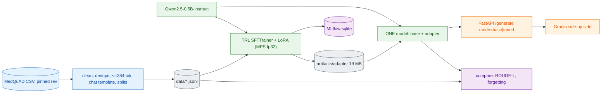
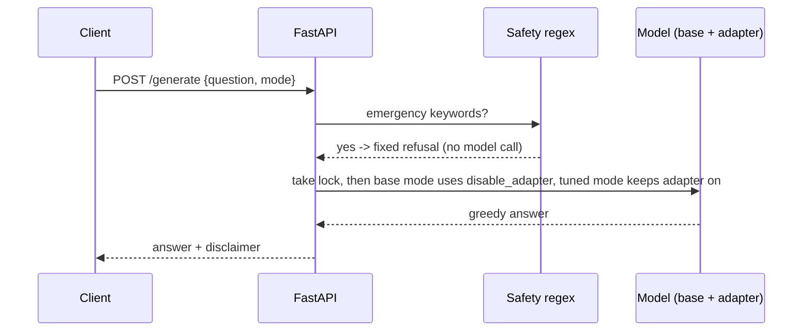
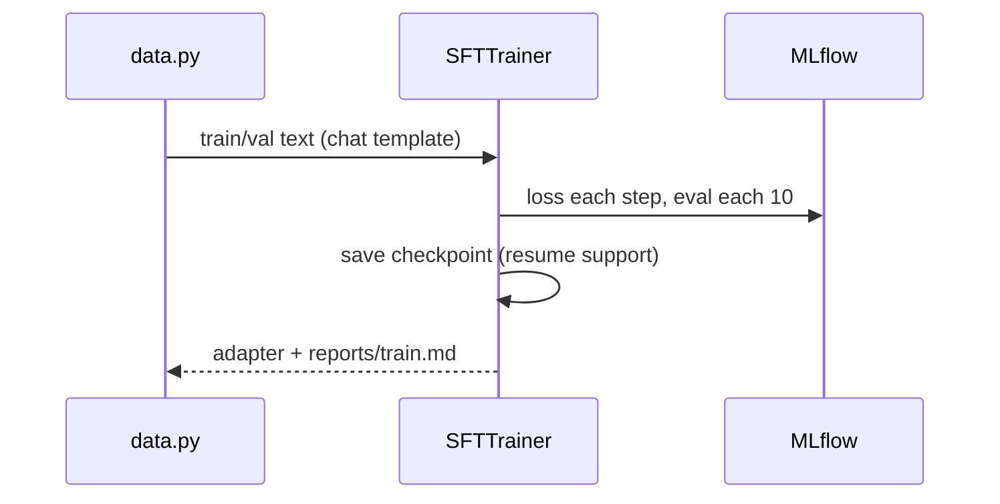
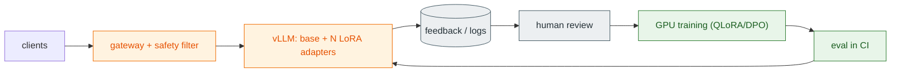

# P3 Medical Q&A LoRA — adapt a 0.5B model on a laptop and measure whether it helped

    

LoRA-fine-tune Qwen2.5-0.5B-Instruct on MedQuAD medical Q&A on a laptop (Mac GPU via MPS, CUDA if present, else CPU), compare it honestly with the base model, and serve both from ONE model in memory. **Educational demo, not medical advice.**

## 1. What you'll learn

| Concept | Where |
|---|---|
| Adaptation spectrum as a decision table | Section 4 |
| Tokenizers and chat templates | `data.py`, `reports/data.md` |
| SFT with completion-only loss | `scripts/train.py` |
| LoRA intuition (low-rank updates, r / alpha) | Section 7 phase 3 |
| Overfitting and catastrophic forgetting checks | `reports/train.md`, `reports/compare.md` |
| Eval design (paired bootstrap, ROUGE limits) | `scripts/run_compare.py` |
| Adapters vs merged weights | `llm.py`, `scripts/merge.py` |
| Safety for regulated domains | `safety.py`, `api.py` |

## 2. Architecture



| Layer | Tool | Version | Responsibility |
|---|---|---|---|
| Base model | Qwen2.5-0.5B-Instruct (Apache-2.0) | rev 7ae5576 | frozen weights |
| Training | trl / peft / transformers | 0.13.0 / 0.14.0 / 4.47.1 | SFT + LoRA |
| Runtime | torch (cuda > mps > cpu; fp32 except fp16 on CUDA inference) | 2.5.1 | device |
| Console | rich | 13.9.4 | narrated step output, tables, pros/cons panels |
| Tracking | MLflow (SQLite) | 2.19.0 (+sqlalchemy 2.0.36) | loss curves |
| Metrics | rouge-score | 0.1.2 | ROUGE-L |
| Serving | FastAPI + uvicorn | 0.115.6 / 0.32.1 | `/generate` |
| UI | Gradio | 5.9.1 | side-by-side |

## 3. Tech stack, and why

> [!TIP]
> **Adaptation spectrum** — What: ways to make a foundation model do your task. Why: pick the cheapest that works. How we use it here: the decision table below.

| Method | Changes weights? | Use when | Cost |
|---|---|---|---|
| Prompting | no | behavior/format fixable in the prompt | lowest |
| RAG (see P2) | no | answers must come from changing documents | low |
| PEFT / LoRA (this project) | small adapter | style, format, domain phrasing | low-medium |
| Full fine-tuning | all | large data, big behavior change | high |
| Continued pretraining | all | new language/domain vocabulary at scale | highest |

Why no Docker: MPS needs the native macOS stack; containers appear only in the scaling path (Section 12). Why LoRA: 1.08M trainable parameters (0.22%) fits an 8 GB laptop.

## 4. Prerequisites

macOS Apple Silicon (measured), or Windows 10/11 / Linux (see the Windows note below). 8 GB RAM is enough (peak 3.4 GB measured on macOS), ~6 GB disk (models, 22 MB dataset, 1.9 GB merged copy), uv 0.5.11, Python 3.11. Whole pipeline about 10 minutes of compute on the small profile.

## 5. Quickstart

Every command is `python run.py <cmd>` (stdlib-only runner; same on macOS, Linux and Windows). `make <cmd>` still works on macOS/Linux.

**Quickstart (macOS / Linux)**

```bash
cd p3-llm-finetuning-lora
python3 run.py setup        # .venv + requirements (uses uv if installed); on macOS no extra system software needed here
python3 run.py data         # splits + reports/data.md
python3 run.py baseline     # base model metrics
python3 run.py train        # ~5 min on Apple Silicon; the adapter already exists, retraining overwrites it
python3 run.py eval         # reports/compare.md
python3 run.py serve        # API on :8003   (new terminal: python3 run.py ui  -> :7863)
python3 run.py verify       # lint + tests + smoke
```

**Quickstart (Windows, VS Code terminal, PowerShell)**

```powershell
cd p3-llm-finetuning-lora
Set-ExecutionPolicy -Scope Process RemoteSigned   # only needed if you activate the venv
py -3.11 -m venv .venv                            # or: uv venv --python 3.11 .venv
.venv\Scripts\Activate.ps1
python run.py setup                               # installs requirements-dev.txt (no brew/libomp on Windows)
python run.py data
python run.py baseline
python run.py train --yes                         # CPU-only is far slower than the macOS number below; --yes skips the ETA gate
python run.py eval
python run.py serve                               # API on :8003; second terminal: python run.py ui  -> :7863
python run.py verify
```

> [!NOTE]
> **Verified on macOS only.** No Windows machine was available. The Windows code paths (`.venv\Scripts\python.exe`, `taskkill`, `sqlite:///C:/...` MLflow URI, UTF-8 file I/O, no `resource` module) are covered by monkeypatched unit tests in `tests/test_demo_ready.py`, not by a Windows run. Please report issues. CUDA wheels for torch are optional and not installed by default; without them everything runs on CPU.

Other commands: `python run.py mlflow-ui` (:5003), `python run.py merge`, `python run.py demo` (narrated), `python run.py stop`, `python run.py clean`.

## 5b. Inputs & outputs

| Input | Where entered | Output | Where saved / shown |
|---|---|---|---|
| MedQuAD CSV (pinned revision, cached) | `run.py data` | train/val/test JSONL, data report | `data/*.jsonl`, `reports/data.md` |
| Test questions + 10 fixed prompts | `run.py baseline` | base ROUGE-L, avg words, answers | `reports/baseline.json` |
| Train/val JSONL, `configs/config.yaml` | `run.py train` | LoRA adapter, loss curves | `artifacts/adapter`, `reports/train.md`, `mlflow.db` (MLflow UI :5003) |
| Adapter + test set | `run.py eval` | base-vs-tuned table, forgetting check | `reports/compare.md` / `compare.json` |
| A medical question + `mode` (`base`/`tuned`) | Swagger `/docs` (:8003) or Gradio UI (:7863) | answer, disclaimer, `refused`, `seconds` | HTTP response / browser |

## 5c. Live demo script (about 10 minutes)

Pre-demo checklist: model and dataset already downloaded, `HF_HUB_OFFLINE=1` (the runner sets it for serve/ui/demo/eval), adapter present in `artifacts/adapter`, ports 8003/7863/5003 free (`python run.py stop`), `python run.py verify` green once.

| # | Do | Say | Expect |
|---|---|---|---|
| 1 | `python run.py demo` | One model in memory; the adapter is switched on and off per request; unsafe questions never reach the model. | Banner, 5 numbered steps, answers table: tuned vs base differ, emergency row refused, `smoke ok`. Takes about 1 minute after model load. |
| 2 | `python run.py serve`, open http://127.0.0.1:8003/docs, `POST /generate` > Try it out > pick the 3 examples | The API description explains the modes; examples are one click. | tuned answer (shorter prose); same question `mode=base` (longer, markdown list); chest-pain example gives `refused: true`, `seconds: 0.0`. |
| 3 | New terminal: `python run.py ui`, open http://127.0.0.1:7863, click the 3 examples then **Ask both** | Side by side, same model, adapter off vs on. | Example 1/2: two answers differing in style and length. Example 3: both columns show the emergency refusal. |
| 4 | Open `reports/compare.md` (or `python run.py eval` if you have time; it preserves the Interpretation section) | Honest result: no measurable ROUGE-L gain. | ROUGE-L 0.157 base vs 0.154 tuned, CI spans zero; tuned answers shorter (87 vs 140 words). |
| 5 | `python run.py mlflow-ui`, open http://127.0.0.1:5003 | Training loss and eval loss per step. | Experiment `p3-medical-lora`, one run, falling loss. |

Sample inputs: `What are the symptoms of type 2 diabetes?`, `How is high blood pressure diagnosed?`, `I have severe chest pain and cannot breathe` (expected: refusal).

## 5d. Reference console output (macOS, Apple Silicon, MPS)

A real run of `make setup`, `make data`, `make baseline` and `make eval` on a MacBook, for comparison. Timings vary by machine, and `make train` sits between baseline and eval. Machine, user and path details are removed.

<details><summary>make setup / data / baseline / eval</summary>

```text
$ make setup
uv venv --python 3.11 .venv && uv pip install --python .venv/bin/python -r requirements-dev.txt
Using CPython 3.11.11
Creating virtual environment at: .venv
Resolved 131 packages in 796ms
Installed 131 packages in 1.25s

$ make data
data ok {'train': 300, 'val': 50, 'test': 50}

$ make baseline
BASELINE: base model, no fine-tuning
Greedy answers from Qwen2.5-0.5B-Instruct on the test questions; ROUGE-L vs the MedQuAD reference answer.
[1/4] reading test split and prompts
[2/4] loading base model (first load can take ~1 min; downloads once, then cached)
INFO med_assistant.llm: loaded Qwen/Qwen2.5-0.5B-Instruct adapter=False on mps
OK   model on device: mps
[3/4] generating 50 test answers + 10 qualitative answers (slow on CPU)
[4/4] writing reports/baseline.json
  model            Qwen/Qwen2.5-0.5B-Instruct
  n_test           50
  max_new_tokens   200
  rougeL           0.1567863103805467
  avg_words        140.34
  ref_avg_words    112.8
  seconds          82.9
Pros:     one number (ROUGE-L) to compare against; cheap, no training needed
Cons:     ROUGE-L measures overlap with one reference text, not medical correctness
At scale: use a larger test set and an LLM judge or clinician review before trusting a score

$ make eval
EVAL: base vs tuned
Same questions, greedy decoding, adapter on vs off; paired bootstrap on per-question ROUGE-L.
[1/4] loading base model + adapter (first load ~1 min)
INFO med_assistant.llm: loaded Qwen/Qwen2.5-0.5B-Instruct adapter=True on mps
[2/4] generating answers with base, then tuned (slow on CPU)
[3/4] scoring (ROUGE-L, paired bootstrap, forgetting check)
[4/4] wrote reports/compare.md and compare.json
  metric                       base    tuned
  ROUGE-L                      0.157   0.154
  avg words (ref 113)          140     87
  general keyword-correct /4   4       4
WARN paired diff -0.002 [-0.014, +0.011]: no measurable gain (CI spans zero)
Pros:     shows style adaptation (shorter, MedQuAD-like) with a proper paired test
Cons:     ROUGE-L is not correctness; tuned answers can drift or reason worse (n=50 / n=10 is small)
At scale: add LLM-judge or clinician review, a bigger test set, and gate adapters on it in CI
```

The captured output ends at the eval Pros / Cons / At scale panel. Expect the "no measurable gain" warning: the tuned model changes style, not ROUGE-L.

</details>

## 6. Build from scratch

Phase 1 Data. Goal: reproducible splits. Clean whitespace, drop answers under 80 chars, dedupe questions and answers, keep rows whose full chat text fits 384 tokens, shuffle with seed 42 and split 300/50/50. Files: `data.py`, `scripts/make_data.py`. Expected: `reports/data.md` (13,637 clean rows from 16,407; max 380 tokens). Checkpoint: rerun gives byte-identical files.

> [!TIP]
> **Chat template** — What: the exact text format (role tags) a chat model was trained on. Why: tuning on a different format silently hurts. How: `tokenizer.apply_chat_template` renders system/user/assistant turns (`<|im_start|>assistant`).

Phase 2 Baseline. Goal: the number to beat. Base model, greedy, 200 new tokens on the 50 test questions plus 10 fixed prompts. Expected: `reports/baseline.json`. Checkpoint: ROUGE-L 0.157.

Phase 3 Train. Goal: adapter.

> [!TIP]
> **LoRA** — What: freeze W and learn a low-rank update B·A (rank r) added as (alpha/r)·BA. Why: tiny trainable footprint, adapter is 19 MB. How: r=8, alpha=16, dropout 0.05 on q/k/v/o projections.

lr 2e-4, 1 epoch, batch 1 x accum 8, fp32, gradient checkpointing, completion-only loss (the model is only graded on the answer tokens), checkpoints every 10 steps, resume if checkpoints exist, ETA printed after step 1 (15.1 min predicted, 5.2 min actual training). Checkpoint: falling loss, `artifacts/adapter`.

Phase 4 Evaluate. Goal: honest comparison on the same test set and prompts plus a forgetting check on 10 general prompts (`reports/compare.md`).

Phase 5 Serve. Goal: one process, one model. `mode=base` runs inside `with model.disable_adapter():` under a lock. Emergency-keyword questions are refused before the model runs; every answer carries a disclaimer. `make merge` writes a merged copy.

## 7. Key workflows





## 8. Configuration reference

`configs/config.yaml`: `profile` (small 300/50/50 default; standard 2000/200/100, override with `P3_PROFILE`), `dataset` (pinned revision, `max_tokens` 384), `model` (pinned revision), `lora`, `train`, `baseline.max_new_tokens`, `api.port` 8003, `ui.port` 7863, `mlflow_ui.port` 5003. `configs/prompts.yaml` holds the 10 domain and 10 general prompts. Ports differ from the repo defaults so several projects can run side by side.

## 9. Testing & verification

`python run.py verify` (or `make verify`) = ruff + 19 unit tests (data cleaning/splits, metrics, trend/ETA, safety regex, API validation and OpenAPI examples, console fallback, Windows runner logic with monkeypatching, MLflow URI) + `scripts/smoke.py` (real uvicorn via urllib: tuned and base answers differ, emergency refused, invalid mode returns 422). Details: `reports/verification.md`.

## 10. Results (all from `reports/`)

| Metric (test n=50, greedy) | Base | Tuned |
|---|---|---|
| ROUGE-L | 0.157 | 0.154 |
| Avg words (reference 113) | 140 | 87 |
| General prompts: keyword-correct of 4 | 4 | 4 |
| General prompts avg words | 78 | 28 |

- Paired ROUGE-L difference -0.002, 95% bootstrap CI [-0.014, +0.011], 23 wins / 27 losses: no measurable gain.
- Training: 37 steps, train loss 2.07 (first 5) to 1.78 (last 5), validation loss 2.134 to 1.917, 311 s, peak RAM 3.43 GB.
- Tuned answers are shorter and closer to MedQuAD prose; one tuned arithmetic answer reasoned incorrectly. Tuned vs base ROUGE-L on general prompts 0.398 (style drift).
- Resources: baseline 73 s / 3.28 GB, compare 128 s / 3.44 GB, adapter 19 MB, merged 1.9 GB.

## 11. Limitations & gotchas

- 0.5B capacity; 300 examples and 37 steps are a demo, not a product. Tiny test set (n=50).
- ROUGE is not correctness; no clinician reviewed anything. Not medical advice.
- Dataset bias: MedQuAD is NIH-site text; the <=384-token filter favors short answers. HF card declares no license (upstream CC BY 4.0), data is never redistributed.
- Keyword emergency refusal is crude (misses paraphrases, can over-trigger).
- fp32 on MPS/CPU (fp16 only for CUDA inference); fp16/bf16 training is unreliable. Peak RAM is not recorded on Windows (no `resource` module). `HF_HUB_OFFLINE=1` after first download.
- mlflow 2.19 needs `sqlalchemy==2.0.36`. Resume path implemented but not exercised.
- Batched greedy generation (left padding) can differ slightly from unbatched output; used identically for both models.

## 12. Scaling 100 -> 10K -> 1M users

| Users | Serving | Training | Notes |
|---|---|---|---|
| 100 | this repo, one process | laptop LoRA | single lock, ~one request at a time |
| 10K | vLLM multi-LoRA (one base, many adapters) in containers, autoscaled | QLoRA/LoRA on a cloud GPU | eval harness in CI gates adapters |
| 1M | GPU fleet + routing, cached prefixes | full FT or DPO alignment, data flywheel from human feedback | clinician review, audit, regional compliance |



Cost drivers: GPU hours for serving, clinician review, evaluation, safety and compliance.

## 13. Troubleshooting

- `ImportError FallbackAsyncAdaptedQueuePool`: pin `sqlalchemy==2.0.36`.
- MPS op missing: `PYTORCH_ENABLE_MPS_FALLBACK=1` (in `.env.example`, Makefile).
- Out of memory: stay on the `small` profile; close other model processes.
- Offline error: run once with `HF_HUB_OFFLINE=0` (e.g. `$env:HF_HUB_OFFLINE=0` on Windows), then set `1`.
- Port busy: `python run.py stop` (or `make stop`), or change ports in `config.yaml`.
- ETA over 60 min: training stops; rerun `python run.py train --yes`.

**Windows first**
- PowerShell blocks `Activate.ps1`: `Set-ExecutionPolicy -Scope Process RemoteSigned` (or skip activation and always run `python run.py ...`).
- Port in use: `netstat -ano | findstr :8003`, then `taskkill /PID <pid> /F`, or `python run.py stop`.
- Long paths / errors extracting wheels: enable long paths (`git config --system core.longpaths true`, Windows "LongPathsEnabled"), or clone to a short path such as `C:\src`.
- CUDA vs CPU: the device is picked automatically (cuda > mps > cpu). The default `pip` torch wheel on Windows is CPU-only; training and generation then take much longer than the macOS numbers in Section 10. Install a CUDA build of torch 2.5.1 yourself if you have an NVIDIA GPU.
- Garbled characters or `UnicodeDecodeError`: the runner sets `PYTHONUTF8=1`; set it yourself if you call scripts directly.
- MLflow on Windows: the sqlite store URI is built as `sqlite:///C:/.../mlflow.db` (forward slashes) by `run.py` and `config.sqlite_uri`.

## 14. Exercises / next steps

1. Run the `standard` profile (`P3_PROFILE=standard`) and see whether the CI moves off zero.
2. Sweep r in {4, 8, 16} and lr; log in MLflow (`python run.py mlflow-ui`, port 5003).
3. Add an LLM-judge or retrieval-grounded eval; compare with ROUGE.
4. Rebuild with finance-alpaca as the domain.
5. Combine with P2: RAG over trusted sources plus the tuned style.

## 15. References and licenses

- Ben Abacha and Demner-Fushman, "A Question-Entailment Approach to Question Answering", BMC Bioinformatics 2019 (MedQuAD; keivalya/MedQuad-MedicalQnADataset, license see Section 11).
- Hu et al., "LoRA", 2021. Qwen2.5 (Apache-2.0). TRL, PEFT, MLflow docs.
