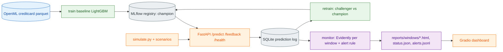

# P4 Fraud Model Monitoring — Plan
Goal: serve a LightGBM fraud model, log every prediction, inject a new fraud pattern, detect drift + decay, alert, retrain champion/challenger. Profile `small` (8 GB), no Docker.

Layout: `src/fraud_monitor/{config,data,model,store,api,scenarios,monitor,retrain}.py`, `scripts/*.py`, `configs/config.yaml`, `tests/`.
Phases (spec): 0 plan/scaffold; 1 baseline; 2 serving+log; 3 simulator; 4 monitoring; 5 dashboard; 6 retrain; 7 verify+readme.
Risks: PR-AUC noise at ~10 frauds/window (guard, see DECISIONS); natural drift on clean days could false-alert (tune on real run); Evidently 0.4.40 speed (20k ref sample).
Acceptance per phase = spec lines; proof in PROGRESS.md.
