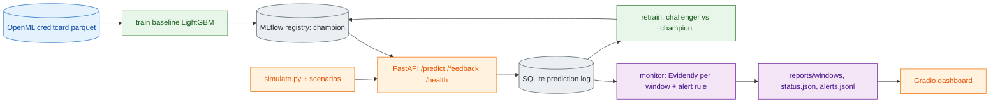
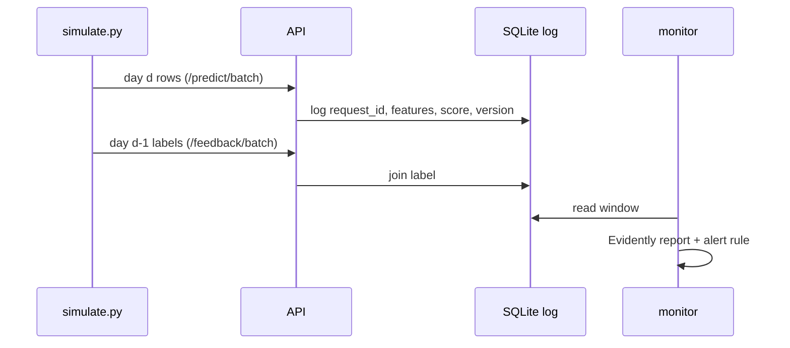
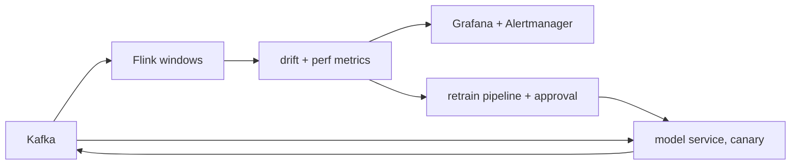

# P4 Fraud Model Monitoring    

Serve a fraud model, log every prediction, inject a new fraud pattern, detect drift and decay, alert, and retrain with a champion/challenger gate. No Docker, no cloud.

## 1. What you'll learn
| Concept | Where |
|---|---|
| Why accuracy is useless at 0.17% fraud (always-legit = 0.9972) | `reports/baseline.json` |
| Data vs prediction vs concept drift | `scenarios.py` (A, B, C) |
| PSI / Wasserstein / share of drifted columns | `monitor.py`, Evidently reports |
| Delayed labels, reference vs current windows | `simulate.py` (lag 1 day) |
| Alert thresholds and alert fatigue | `monitor.py` guard, DECISIONS.md |
| Champion/challenger promotion | `retrain.py` |

## 2. Architecture

| Layer | Tool | Version | Responsibility |
|---|---|---|---|
| Model | LightGBM | 4.5.0 | fraud scorer, PR-AUC primary metric |
| Registry | MLflow (SQLite) | 2.19.0 | `champion` alias |
| Serving | FastAPI + uvicorn | 0.115.6 / 0.32.1 | predict, feedback, log |
| Log | SQLite | stdlib | one row per prediction, labels joined later |
| Monitoring | Evidently | 0.4.40 (legacy API) | drift + classification reports |
| UI | Gradio | 5.9.1 | metrics over time, alert markers, report links |

## 3. Why these tools
SQLite and MLflow-on-SQLite need no server; Evidently 0.4.40 has the stable Report/TestSuite API the spec pins; Gradio is the single UI framework. No Docker: everything runs natively on 8 GB. Containers belong to the scaling path (section 11).

> [!TIP]
> **Delayed labels** — What: ground truth arrives after the prediction. Why: fraud is confirmed days later, so performance is always stale. How here: `/feedback` for day d-1 is sent after day d; drift share alerts same day, PR-AUC alerts one day later.

## 4. Prerequisites
Python 3.11, ~1 GB disk (plus ~90 MB of regenerated Evidently HTML), 8 GB RAM, `uv` (or plain `venv` + `pip`). macOS: `brew install libomp` (LightGBM). Windows: nothing extra, CPU only. Baseline training peaked at 725 MB RAM.

> [!NOTE]
> Verified on macOS (Apple Silicon). There was no Windows machine available: the Windows code paths (venv `Scripts\python.exe`, `taskkill`, no bash/curl) are covered by unit tests with monkeypatched platform checks, not by a Windows run. Please report issues.

## 5. Quickstart
`python run.py <command>` is the cross-platform entry point (the Makefile stays for macOS and calls the same scripts).

**macOS / Linux**
```bash
cd p4-model-monitoring-drift
python3 run.py setup        # creates .venv, installs pinned deps
python run.py data && python run.py train
python run.py demo          # narrated end-to-end run, ~3 min
python run.py ui            # http://127.0.0.1:7864
```
**Windows (VS Code, PowerShell)**
```powershell
cd p4-model-monitoring-drift
Set-ExecutionPolicy -Scope Process RemoteSigned   # only if activating the venv is blocked
py -3.11 run.py setup
.\.venv\Scripts\python.exe run.py data
.\.venv\Scripts\python.exe run.py train
.\.venv\Scripts\python.exe run.py demo
.\.venv\Scripts\python.exe run.py ui           # http://127.0.0.1:7864
```
(`python run.py ...` also works once the venv is activated with `.\.venv\Scripts\Activate.ps1`; `run.py` finds the venv itself.)

Other commands: `serve` (API on 8004, Swagger at `/docs`), `simulate`, `monitor`, `retrain`, `mlflow-ui` (5004), `test`, `lint`, `smoke`, `verify`, `stop`, `clean`. Extra options are passed through, e.g. `python run.py simulate --reset --scenario B --start-day 6`.

## 5a. Inputs and outputs
| Input | Entered where | Output | Saved to |
|---|---|---|---|
| Transaction features (V1..V28, Amount: 29 numbers) | Swagger `POST /predict` (two real example rows are pre-filled) | `score`, `is_fraud`, `model_version` | prediction log `artifacts/predictions.db` |
| True label of a request | Swagger `POST /feedback` | `matched: 1` | same log, joined by `request_id` |
| Scenario (A/B/C/none) + start day | dashboard radio + number, or `run.py demo --scenario` | 10 simulated days of traffic | prediction log (`.run/ui_demo.db` for the dashboard, `.run/demo.db` for the CLI demo) |
| Click "Monitor" / `run.py monitor` | dashboard / terminal | per-window drift share, PSI, PR-AUC, alert flag | `reports/demo/status.json`, `alerts.jsonl`, `windows/*.html` |
| Click "Retrain" / `run.py retrain` | dashboard / terminal | champion vs challenger PR-AUC, promote or reject | `reports/demo/retrain.json`, new MLflow model version |

Scenarios: **A** Amount x3 (data drift), **B** new fraud cluster (drift plus decay), **C** concept flip in a segment, **none** clean traffic.

## 5b. Live demo script (about 10 minutes)
Pre-demo checklist: `python run.py data` and `python run.py train` done once; ports 8004, 7864, 5004 free (`python run.py stop`); `.venv` active or use `run.py` directly.

| # | Do | Say | Expect |
|---|---|---|---|
| 1 | `python run.py demo` | "A fraud model serves traffic; on day 6 a new fraud pattern appears." | Narrated steps: reset champion, start API, 10 simulated days, monitor, retrain dry run |
| 2 | Read the monitor table | "Drift share needs no labels, so it fires the day the pattern starts." | Windows 3-5 ok; window 6 ALERT (drift share 0.34, PR-AUC 0.393 vs baseline 0.801), see `reports/verification.md` |
| 3 | Read the retrain verdict | "Promote only if clearly better." | Champion about 0.247 vs challenger about 0.979 on window 9 (same as `reports/scenB/retrain.json`); alias not moved without `--promote` |
| 4 | `python run.py ui`, choose *Latest demo run* | "Red bands are alert windows; top = drift, bottom = PR-AUC." | Plot, table, links to the Evidently report per window |
| 5 | Click-driven: radio **B**, day **6**, press **1. Simulate**, **2. Monitor**, **3. Retrain** | "Same pipeline, now by clicks." | About 1 min each; status text under the buttons. Try the ready samples A and C and compare |
| 6 | `python run.py serve`, open `http://127.0.0.1:8004/docs`, `POST /predict` with the *demo-legit-1* then *demo-fraud-1* example | "Real rows from the reference data; logged for monitoring." | A `score` between 0 and 1 and the model version; then `POST /feedback` with the same `request_id` |
| 7 | `python run.py mlflow-ui` (http://127.0.0.1:5004) | "Every model version is registered; the alias `champion` is what the API loads." | Model `fraud` with versions and the `champion` alias |

## 5c. Reference console output (macOS, Apple Silicon)

A real run of `python run.py data`, `train`, `demo` and `ui`, for comparison. Timings and registry version numbers vary per run. Machine, user and path details are removed. Repeated `httpx` request lines and `alembic` start-up lines are collapsed into one `...` line each, and boxed panels are shown as plain text.

<details><summary>data and train</summary>

```text
$ python run.py data
data: Load the creditcard fraud data, split by row order 60/40 into reference and stream, sample the stream into 10 days (all frauds kept).
Expect: a summary table and the per-day fraud counts
[1/3] loading raw data (cached after the first download)
[2/3] splitting reference / stream
[3/3] writing parquet files
  part              rows     fraud rate
  raw               284807   0.00173
  reference         170884   0.00211
  stream (full)     113923   0.00116
  stream (sampled)  22132    0.00596

  stream days: day / rows / frauds
  1 2214 5     |  6  2214 18
  2 2213 16    |  7  2213 23
  3 2213 12    |  8  2213 15
  4 2213 10    |  9  2213 9
  5 2213 14    | 10  2213 10
Pros:     time-ordered split means no future leakage into the reference
Cons:     the stream is enriched with frauds (higher base rate than real life) so per-window PR-AUC is measurable
At scale: replace the parquet files with a warehouse table and a streaming ingest

$ python run.py train
train baseline: LightGBM on the first 80% of the reference rows, validated on the last 20% (time order).
Expect: PR-AUC (the primary metric) well above accuracy-for-free; takes under a minute on CPU
[1/3] loading reference data
[2/3] fitting on 136708 rows (263 frauds)
[3/3] registering the model in MLflow and setting alias `champion`
INFO alembic.runtime.*: ...
WARNING mlflow.models.model: Model logged without a signature and input example.
Registered model 'fraud' already exists. Creating a new version of this model...
Created version '4' of model 'fraud'.
  PR-AUC (val)           0.801
  accuracy (val)         0.9989
  always-legit accuracy  0.9972
  recall                 0.773
  precision              0.824
  champion version       4
  wall_time_s            10.0
Pros:     PR-AUC ignores the huge legit majority, so it exposes what accuracy hides
Cons:     one fixed split and ~100 training frauds: the number is indicative, not a benchmark
At scale: add a feature store, time-based CV and a registry approval step
```

</details>

<details><summary>demo (serve, simulate scenario B, monitor, retrain)</summary>

```text
$ python run.py demo
end-to-end demo: Serve the champion model, replay 10 days of traffic with scenario B (from day 6), monitor every window, then try a retrain.
Expect: alert around the injection day; retrain challenger beats the decayed champion (about 3 minutes)
[1/6] checking prerequisites
OK   data, baseline report present; port free
[2/6] resetting champion alias to the baseline model (same starting point every run)
OK   champion is now v1 (reload a running API with POST /reload)
[3/6] starting the API (prediction log: .run/demo.db)
OK   API healthy at http://127.0.0.1:8004  (Swagger: http://127.0.0.1:8004/docs)
[4/6] simulating traffic
simulate: Send each simulated day to /predict/batch, then the previous day's labels to /feedback/batch. Scenario: B from day 6
[1/3] loading reference + stream parquet
[2/3] replaying days through the API
INFO httpx: HTTP Request: POST http://127.0.0.1:8004/predict/batch "HTTP/1.1 200 OK"  (x3 per day, plus /feedback/batch from day 2)
     day 1/10 sent (0s)
     ...
     day 10/10 sent (1s)
[3/3] summary
  sent             22132
  labels_fed       19919
  unlabelled_tail  2213
  wall_time_s      1.4
Pros:     every prediction is logged with its features, so any window can be re-analysed later
Cons:     labels lag by design: the newest day has no ground truth yet (unlabelled_tail)
At scale: a Kafka topic replaces the HTTP replay; labels come from a chargeback pipeline

[5/6] monitoring every window
monitor: Alert when drift share > 0.3 OR PR-AUC drops > 10% vs baseline (needs >= 10 labelled frauds).
Expect: one line per window (about 9 s each: Evidently renders an HTML report per window)
[1/2] running Evidently on every window
WARNING fraud_monitor.monitor: ALERT window 6: drift_share 0.34 > 0.3; pr_auc 0.393 dropped 51% vs baseline 0.801
...
WARNING fraud_monitor.monitor: ALERT window 10: drift_share 0.62 > 0.3
[2/2] results
  window  n     frauds  drift_share  psi    pr_auc  alert
  3       2213  12      0.07         0.011  0.788   False
  4       2213  10      0.00         0.007  0.803   False
  5       2213  14      0.03         0.006  0.819   False
  6       2214  62      0.34         0.008  0.393   True
  7       2213  67      0.34         0.015  0.384   True
  8       2213  59      0.52         0.010  0.279   True
  9       2213  53      0.59         0.007  0.247   True
  10      2213  0       0.62         0.008  n/a     True
  windows      8
  alerts       5
  wall_time_s  15.7
Pros:     drift share alerts the same day, before labels exist; PR-AUC confirms real damage later
Cons:     PR-AUC on ~10 frauds is noisy (guard skips windows with too few); labels arrive late
At scale: per-feature drift x many models needs a scheduled job + metrics store (Prometheus/Grafana), not HTML files

[6/6] retraining (dry run unless --promote)
retrain: Fit a challenger on days before the latest window, score both models on that window, promote only if the gain is >= retrain.min_improvement and the old pattern is not forgotten.
Expect: champion vs challenger PR-AUC and a promote / reject verdict (~1 min)
[1/2] training challenger and comparing
INFO alembic.runtime.*: ...
Created version '5' of model 'fraud'.
INFO fraud_monitor.retrain: retrain: promoted=True (window PR-AUC 0.979 vs champion 0.247)
[2/2] verdict
OK   evaluated on window 9 (17706 new labelled rows, 245 frauds)
OK   champion v4 PR-AUC 0.247 vs challenger v5 0.979 -> challenger passes the gate
OK   alias NOT moved (dry run: pass --promote / tick the box to switch the champion)
  eval_window     9
  gate_passed     True
  alias_updated   False
  champion_after  4
Pros:     a gate (min gain + no regression on the old pattern) stops noisy promotions
Cons:     a few hundred labelled frauds only; the synthetic cluster is easy, real gains are smaller
At scale: needs shadow scoring, approval steps and a rollback alias in a real registry
OK   demo finished: API stopped. Next: `python run.py ui` and pick 'Latest demo run'; `python run.py mlflow-ui` for the registry
```

</details>

<details><summary>ui</summary>

```text
$ python run.py ui
dashboard: Gradio UI on http://127.0.0.1:7864
Expect: buttons: 1 Simulate, 2 Monitor, 3 Retrain
* Running on local URL:  http://127.0.0.1:7864
```

</details>

## 6. Build from scratch
| Phase | Goal | Checkpoint |
|---|---|---|
| 1 Baseline | LightGBM, PR-AUC 0.801 on validation (accuracy 0.9989 vs always-legit 0.9972) | `reports/baseline.json` |
| 2 Serving | `/predict`, `/feedback`, `/health`, `/reload`; all predictions logged | `python run.py smoke` |
| 3 Simulator | stream = 22,132 rows (all 132 stream frauds + 22,000 legit), 10 days of ~2,213 rows | `scripts/simulate.py` |
| 4 Monitoring | rule: drift share > 0.3 OR PR-AUC drop > 10% (needs >= 10 labelled frauds) | `reports/status.json` |
| 5 Dashboard | drift share and PR-AUC over time, alert markers, links | `python run.py ui` |
| 6 Retrain | challenger on days before window vs champion on the latest window | `reports/scenB/retrain.json` |

Scenario generation (exact): A multiplies Amount by 3 with lognormal(0, 0.1) noise. B overwrites 2% of each day's legit rows with a synthetic fraud cluster, 5 legit-std away (opposite to real fraud) on the 14 most fraud-discriminative features, label 1. C flips 50% of frauds in the segment V1 > median to 0 and the same number of legit rows to 1.

## 7. Key workflow


## 8. Configuration
`configs/config.yaml`: `profile` (small default), `ports` (8004/7864/5004), `scenario` (name, start_day, params), `monitor` (`ref_days: 2`, `drift_share_threshold: 0.3`, `pr_auc_drop_threshold: 0.10`, `min_frauds_for_perf: 10`), `retrain.min_improvement: 0.02`.

## 9. Testing
`python run.py verify` (or `make verify`) = ruff + pytest + smoke against a real uvicorn. Tests cover the API, scenarios, dashboard helpers, the console fallback and the `run.py` path logic (including Windows branches via monkeypatching). Details in `reports/verification.md`.

## 10. Results (real runs, `reports/`)
| Run | Windows | Outcome |
|---|---|---|
| Clean (no scenario) | 3-9 | no alert; drift share 0.00-0.28 |
| Clean | 10 | alert, drift share 0.38 (slow natural drift, 0 frauds) |
| Scenario B from day 6 | 3-5 | no alert |
| Scenario B | 6 | alert: drift share 0.34, PR-AUC 0.393 (-51% vs 0.801) |
| Scenario B | 9 | PR-AUC 0.247 |
| Retrain on window 9 | | champion 0.247 vs challenger 0.979, promoted |

## 11. Limitations and gotchas
- Features are anonymised PCA components; drift is synthetic; monitoring is batch, not streaming.
- The stream is enriched (0.6% fraud vs the real ~0.12%) so per-window PR-AUC is measurable.
- This OpenML copy has no `Time` column; row order is used as time.
- Drift against the training-period reference alerted on 83% of features on clean days (training period and stream differ). The drift reference is therefore stream days 1-2; set `ref_days: 0` to compare with the training period.
- 1 false alert in 8 clean windows (window 10). PR-AUC on ~10 frauds is noisy; the 10-fraud guard exists for that reason.
- The synthetic cluster is easy to learn once labelled; real retrain gains will be smaller.
- Evidently 0.4.40 HTML needs `plotly==5.24.1` (plotly 7 removed `create_distplot`).

## 12. Scaling 100 -> 10K -> 1M users
| Scale | Change |
|---|---|
| 100 (here) | one process, SQLite, on-demand monitor |
| 10K | Postgres log, scheduled monitor, Prometheus + Grafana + Alertmanager |
| 1M | Kafka event log, Flink/Spark windows, Feast features, label pipeline, shadow + canary in containers, retrain pipeline with approval gates |

Cost drivers: log storage, label latency, drift compute per feature per window.

## 13. Troubleshooting
**Windows first**
- Venv will not activate: `Set-ExecutionPolicy -Scope Process RemoteSigned`, or skip activation and call `.\.venv\Scripts\python.exe run.py ...`.
- Port busy: `netstat -ano | findstr :8004`, then `taskkill /PID <pid> /T /F` (or `python run.py stop`).
- Long paths: clone close to the drive root, or enable long paths in Windows/git.
- CPU only: LightGBM and Evidently run on CPU everywhere; no CUDA setup is needed.

**macOS / all**
- `lightgbm` import error: `brew install libomp`.
- `monitor` fails rendering HTML: `uv pip install plotly==5.24.1`.
- mlflow import error: keep `sqlalchemy==2.0.36`.
- API fails at startup with "No such file ... mlruns": the project folder was moved or renamed and the MLflow registry stored absolute paths. Re-run `python run.py train`, or rewrite the old prefix in `artifacts/mlflow.db` (tables `experiments`, `runs`, `model_versions`).
- Port busy: `python run.py stop`, then `lsof -ti :8004`.

## 14. Exercises
Run scenarios A and C and compare which drift tests fire; tune the threshold for recall vs precision; add a shadow model scored but not served; make the drift reference a rolling window.

## 15. References and licenses
OpenML creditcard fraud (data_id 1597; ODbL, Worldline/ULB); LightGBM (MIT); Evidently (Apache-2.0); MLflow (Apache-2.0); Gradio (Apache-2.0).
