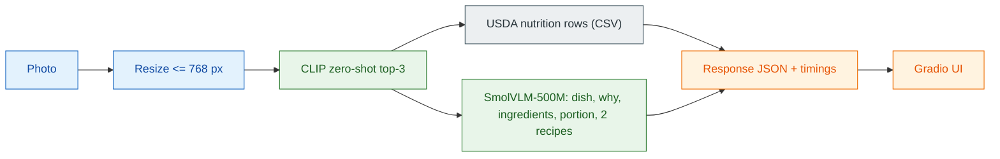
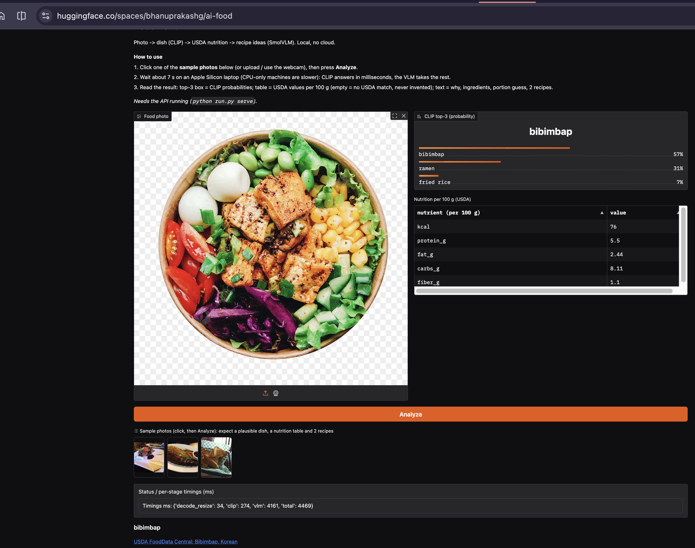
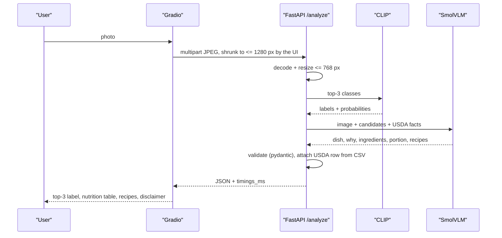
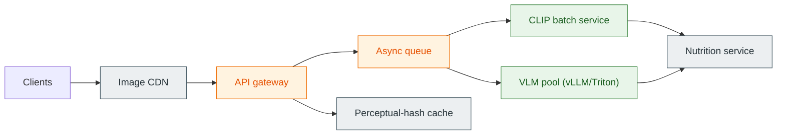

# Food Lens 🍽️
   

Upload a food photo, get the likely dish, USDA nutrition per 100 g and two recipe ideas, fully local after one-time downloads.

## 1. What you'll learn
| Concept | Where |
|---|---|
| Contrastive learning, shared image/text embedding space | `src/food_lens/clip_zs.py` |
| Zero-shot classification + prompt ensembling | 5 templates averaged per class |
| Vision-language model (VLM) on a laptop | `src/food_lens/vlm.py` |
| Grounding (no hallucinated numbers) | nutrition comes only from the USDA CSV |
| Structured output: extract, pydantic, retry, typed error | `schema.py`, `vlm.analyze` |
| Latency budgets | per-stage `timings_ms` in every response |

## 2. Architecture

| Layer | Tool | Version | Responsibility |
|---|---|---|---|
| Classifier | open_clip, `laion2b_s34b_b79k` ViT-B-32 | open_clip_torch 2.29.0 | zero-shot top-3 over 101 Food-101 classes |
| VLM | SmolVLM-500M-Instruct via transformers | transformers 4.47.1, torch 2.5.1 | dish choice among CLIP candidates, description, recipes |
| Nutrition | USDA FoodData Central bulk CSV (SR Legacy 2018-04 + FNDDS 2024-10-31) | n/a | kcal, protein, fat, carbs, fiber per 100 g |
| API | FastAPI + uvicorn | 0.115.6 / 0.32.1 | `/health`, `/analyze` |
| UI | Gradio | 5.9.1 | upload/webcam, top-3 label, tables |

## 3. Tech stack and why
- **CLIP zero-shot** needs no training and no labels beyond class names; **SmolVLM-500M** over Qwen2-VL-2B because it is already ~1 GB and fits 8 GB next to CLIP (Qwen2-VL-2B is the documented `standard` alternative, untested here).
- **CSV instead of a database**: 101 rows. **Bulk CSV instead of the API**: the DEMO_KEY allows about 10 calls/hour, which cannot cover 101 classes.
- **No Docker**: everything runs in-process on MPS; containers appear only in the scaling path (section 13).

> [!TIP]
> **CLIP** - What: a model trained to put images and captions close together in one vector space. Why: you can classify by comparing a photo with the text "a photo of pizza, a type of food" with no training. How here: text embeddings of 101 classes (5 templates averaged) are cached to `.npy`; a photo is one matrix multiply.

## 4. Prerequisites
8 GB RAM is enough (peak 2.5 GB measured on macOS Apple Silicon), about 2 GB disk for models plus the USDA zips, Python 3.11, internet for the first run only. Device is picked automatically: CUDA, then Apple MPS, then CPU. On a CPU-only Windows laptop expect the VLM stage to be slower than the macOS numbers below.

> [!NOTE]
> **Verified on macOS (Apple Silicon).** The Windows path (`run.py`, `scripts/smoke.py`, device selection) is covered by unit tests with monkeypatched OS checks but has not been run on a real Windows machine. Please report issues.

## 5. Quickstart
`run.py` is stdlib-only and works the same everywhere; `make <cmd>` on macOS/Linux just calls it.

**macOS / Linux**
```bash
cd p5-multimodal-ai-food
python3 run.py setup     # uv venv + pinned deps (or plain venv + pip if uv is missing)
python3 run.py models    # CLIP + SmolVLM at pinned revisions
python3 run.py eval      # caches a 300-image Food-101 sample, writes reports/clip_eval.json
python3 run.py data      # USDA bulk CSVs -> data/nutrition.csv, reports/mapping_review.md
python3 run.py demo      # narrated run on cached photos
python3 run.py serve     # API on :8005, Swagger at /docs (terminal 1)
python3 run.py ui        # Gradio on :7865 (terminal 2)
python3 run.py verify    # lint + tests + smoke;  python3 run.py stop
```

**Windows (VS Code terminal, PowerShell)**
```powershell
cd p5-multimodal-ai-food
Set-ExecutionPolicy -Scope Process RemoteSigned     # only if activation is blocked
py -3.11 run.py setup                               # creates .venv, installs pinned deps (no brew/libomp needed)
.venv\Scripts\Activate.ps1                          # optional: run.py finds .venv itself
python run.py models
python run.py eval
python run.py data
python run.py demo
python run.py serve      # terminal 1
python run.py ui         # terminal 2
python run.py verify
```
`run.py` sets `HF_HUB_OFFLINE=1` itself for `serve`, `demo` and `smoke`, so models must be downloaded first. Optional: `NO_COLOR=1` turns off console colors. CUDA wheels for a Windows GPU are optional and not installed here.

## Inputs and outputs
| Input | Where you enter it | Output | Where it ends up |
|---|---|---|---|
| Food photo (JPEG/PNG/WebP; the UI shrinks big photos, the API itself caps uploads at 5 MB) | Gradio upload/webcam/sample on :7865, or `POST /analyze` in Swagger (:8005/docs) | dish, CLIP top-3, USDA nutrition per 100 g, why/ingredients/portion/2 recipes, `timings_ms` | UI panels / JSON response |
| Cached Food-101 sample (300 images) | `python run.py eval` | top-1 / top-5, seconds per image, device | `reports/clip_eval.json` |
| USDA bulk CSVs (or `FDC_API_KEY`) | `python run.py data` | 101-row nutrition table, review list | `data/nutrition.csv`, `reports/mapping_review.md` |
| Cached sample photos | `python run.py demo [--n N]` | narrated table with per-stage timings | console, `reports/vlm_demo.json`, `reports/vlm_demo.md` |

Three sample photos (`assets/sample_*.jpg`, resized to 384 px, under 100 KB each) are resized copies from the Food-101 validation split (research use, see section 16) and appear as clickable examples in the UI.

## Deploy to Hugging Face Spaces
The same app runs as a public Space (UI + `POST /analyze` in one process on port 7860). Example: <https://huggingface.co/spaces/<your-username>/ai-eng-projects>.



*Sample run on the Space: CLIP top-3, USDA nutrition table, per-stage timings (`decode_resize` 34 ms, `clip` 274 ms, `vlm` 4161 ms, `total` 4469 ms).*

**Step by step**
1. Create a Space at <https://huggingface.co/new-space>: SDK **Gradio**, hardware **ZeroGPU** or CPU basic, name e.g. `ai-food`.
2. Create a **write** token at <https://huggingface.co/settings/tokens>. It is read from the environment only and never written to disk.
3. Build the nutrition data once (the CSV is gitignored but must be uploaded): `python3 run.py data`.
4. Dry run, staging folder only (default `.run/hf_space`): `python3 scripts/deploy_space.py --space <user>/ai-food --no-upload`.
5. Upload: `HF_TOKEN=hf_xxx python3 scripts/deploy_space.py --space <user>/ai-food` (PowerShell: `$env:HF_TOKEN="hf_xxx"; python scripts/deploy_space.py --space <user>/ai-food`).
6. Wait a few minutes for the Space to rebuild, then open it, click a sample photo and press **Analyze**. The first request after a cold start is slower while models load.
7. Redeploy after any code change by repeating step 5 (each run is one new commit on the Space).

**What gets deployed** (`scripts/deploy_space.py`, 3 steps: stage, upload, check status)
| Staged file | Source | Why |
|---|---|---|
| `app.py`, `README.md`, `requirements.txt` | `deploy/hf_space/` | Space entry point, Space metadata (front matter: `sdk: gradio`, `sdk_version: 5.9.1`, `python_version: "3.11"`), Space-only pins (`torch==2.8.0`, `spaces`, `open_clip_torch`, `pillow`, `rich`) |
| `src/food_lens/`, `scripts/ui.py`, `configs/config.yaml` | project | pipeline, API, UI, config |
| `data/nutrition.csv`, `data/labels.json` | `python run.py data` | USDA lookup and class names (script stops with `missing ...` if absent) |
| `artifacts/clip_text_emb.npy` | local cache | optional, skipped if missing |
| `assets/*.jpg` (<= 100 KB each) | project | sample photos shown under the Analyze button |

**How `deploy/hf_space/app.py` works**
- Loads CLIP and SmolVLM once at startup, then mounts `/health` and `/analyze` ahead of Gradio's catch-all routes so one process serves both.
- Inference goes through a module-level function wrapped in `spaces.GPU(duration=60)` when the `spaces` package exists (ZeroGPU); locally and on CPU it is a plain call.
- One request at a time (`asyncio.Semaphore(1)`). The UI calls the API in the same process via `FOOD_LENS_API=http://127.0.0.1:$PORT`.

**Config and env for the Space**
| Setting | Where | Value |
|---|---|---|
| `HF_TOKEN` | your shell, deploy only | write token |
| `PORT` | env, optional | 7860 (default) |
| `FOOD_LENS_NO_VLM=1` | Space variable, optional | CLIP only, much faster, no recipes |
| `FOOD_LENS_API` | set by `app.py` | local URL of the same process |
| models and revisions | `configs/config.yaml` | unchanged from the local build |

**Logs and status**
- Deploy script output: `[1/3] staging into ...` then `N files staged`, `[2/3] uploading`, `[3/3] stage: <RUNNING|BUILDING|...>` and the Space URL.
- Build and runtime logs: Space page, **Logs** tab (Build / Container). Look for model-load lines at startup and Python tracebacks on a failed request.
- Per request: the UI status box prints `Timings ms: {decode_resize, clip, vlm, total}`; the API returns the same as `timings_ms`.
- Check the API: `curl https://<user>-ai-food.hf.space/health`.

**What changed for the Space**
- UI: the top-3 bar plot became `gr.Label` (works in the Space's Gradio build); the result is a dict of `dish: probability`.
- UI: photos are shrunk to <= 1280 px and re-encoded as JPEG before upload (`shrink()` in `scripts/ui.py`), so large phone photos no longer hit the API's 5 MB limit (`413`).
- API/UI: EXIF orientation is applied (`ImageOps.exif_transpose`), so rotated phone photos classify correctly.
- UI: API errors now show the status code and server detail (`API error 413: ...`), and an unreachable API is reported separately.
- New: `scripts/deploy_space.py`, `deploy/hf_space/`, `assets/sample-output.png`, sample photos in `assets/`.

## Live demo script (about 10 minutes)
**Pre-demo checklist:** models downloaded (`python run.py models`), `data/nutrition.csv` exists, ports 8005 and 7865 free (`python run.py stop`), `python run.py verify` green once.

| # | Do | Say | Expect |
|---|---|---|---|
| 1 | `python run.py demo --n 3` | "Three stages: CLIP shortlists, USDA grounds the numbers, a small VLM explains." | banner, 4 numbered steps, table with clip vs vlm ms, Pros/Cons/At scale panel |
| 2 | `python run.py serve`, open `http://127.0.0.1:8005/docs` | "One endpoint, typed response." | `POST /analyze` -> Try it out -> upload `assets/sample_1_cheese_plate.jpg` -> `top3`, `nutrition`, `vlm`, `timings_ms` |
| 3 | `python run.py ui`, open `http://127.0.0.1:7865` | "Same API, friendlier." | click each of the 3 sample photos then Analyze: bar plot, nutrition table, recipes |
| 4 | Point at the nutrition table of a class with no USDA match | "Missing stays empty, never invented." | empty values and the USDA-match note |
| 5 | Open `reports/vlm_demo.md` | "Only measured numbers are quoted." | 6 rows, valid-JSON count, timings |
| 6 | `python run.py stop` | | both processes stopped |

Sample photos shipped: `sample_1_cheese_plate.jpg`, `sample_2_baby_back_ribs.jpg`, `sample_3_grilled_cheese_sandwich.jpg` (labels from the Food-101 sample metadata; the model's guess may differ, that is part of the story).

## 6. Build from scratch (one step per phase)
| Phase | Goal | Command | Files | Checkpoint |
|---|---|---|---|---|
| 0 | scaffold, pinned models | `make models` | `scripts/download_models.py`, `config.yaml` | offline load works |
| 1 | CLIP zero-shot | `make eval` | `clip_zs.py`, `scripts/eval_clip.py` | `reports/clip_eval.json`: top-1 0.83, top-5 0.97 |
| 2 | nutrition DB | `make data` | `scripts/build_nutrition.py`, `usda.py` | 101 classes, 86 matched, 15 null |
| 3 | VLM reasoning | `make demo` | `vlm.py`, `schema.py`, `pipeline.py` | `reports/vlm_demo.md`: 6/6 valid JSON |
| 4 | API | `make smoke` | `api.py`, `scripts/smoke.py` | 3 images ok, oversize returns 413 |
| 5 | UI | `make ui` | `scripts/ui.py` | HTTP 200 on 7865 |

> [!TIP]
> **Grounding** - What: the model may only talk about facts you give it. Why: small VLMs invent numbers. How here: the prompt forbids calorie claims, a pydantic validator rejects text mentioning kcal/protein, and nutrition fields are read from the CSV, never from the VLM.

> [!NOTE]
> Phase 3 lesson: asking SmolVLM-500M for the whole 5-field JSON in one reply gave 0/6 valid objects (it copied the template or truncated). The fix was one short question per field with the JSON assembled in code, then the usual pydantic validation, one retry with the error appended, and a typed error. Result: 6/6 valid.

## 7. Key workflows


## 8. Configuration reference
`configs/config.yaml`: `profile` (small|standard), `models.clip|vlm` (repo + pinned revision), `vlm.max_new_tokens/max_image_px/image_splitting`, `eval.n_images`, `api.max_upload_bytes` (5 MB), `api.max_image_side` (768), `api.top_k` (3), `ports` (API 8005, UI 7865). Env: `FDC_API_KEY` (optional, switches to the FDC search API), `HF_HUB_OFFLINE`, `FOOD_LENS_NO_VLM=1` (CLIP only), `FOOD_LENS_API` (UI target).

## 9. Testing and verification
`python run.py verify` (or `make verify`) = ruff + 23 pytest tests (JSON extraction, retry, typed error, USDA matching, UI helpers, `run.py` path/OS logic with monkeypatched `os.name`, console fallback, device order, API schema example) + `scripts/smoke.py` (real uvicorn, 3 real images, oversize rejected, UI up, `ui.analyze` end-to-end, urllib instead of curl). Details: `reports/verification.md`.

## 10. Results (real runs only)
| Metric | Value | Source |
|---|---|---|
| CLIP top-1 / top-5, 300 Food-101 validation images | 0.83 / 0.97 | `reports/clip_eval.json` |
| CLIP latency | 22 ms/image (MPS) | `reports/clip_eval.json` |
| Nutrition coverage | 86 of 101 classes with USDA kcal; 15 null; 21 flagged for review | `reports/mapping_review.md` |
| VLM valid JSON | 6/6, 0 retries | `reports/vlm_demo.md` |
| End-to-end latency (latest `demo` run, other jobs were using the machine) | median 13.3 s per photo (VLM 13.2 s), max 17.6 s | `reports/vlm_demo.md` |
| End-to-end latency (earlier quiet run) | median 6.2 s per photo; smoke 6.6-7.5 s | `reports/resources.md` |
| Model load | 8.3 s (latest run); 5.3 s (earlier quiet run) | `reports/vlm_demo.md`, `reports/resources.md` |
| Peak RAM | 2.47 GB | `reports/resources.md` |

## 11. Limitations and gotchas
- Mixed plates, regional dishes outside Food-101, and anything not among the 101 classes are misclassified or forced into a wrong class.
- Nutrition is a generic USDA food, not your plate; 15 classes have no match and show empty values; some matches are loose (for example `prime_rib`, `french_fries`).
- Portion size is a visual guess from a 500M model and is flagged as an estimate; recipe text is generic.
- The VLM dish choice has no measured accuracy (6 demo images, no ground truth). The dish is always one of CLIP's top-3.
- Latency is about 6 s per photo on this laptop; one request at a time.
- Not medical or dietary advice.

## 12. Why no Docker here
Local, single user, in-process models on MPS. Docker on macOS cannot use MPS, and the extra VM would not fit comfortably in 8 GB.

## 13. Scaling 100 to 10K to 1M users
| Users | Change | Cost drivers |
|---|---|---|
| 100 | this repo, one process | laptop |
| 10K | one GPU server, batch CLIP, queue for the VLM, cache by perceptual hash, nutrition as a small service | GPU hours |
| 1M | Triton/vLLM pools in containers, image CDN, async queue, CLIP linear probe or fine-tune, autoscaling | GPU, egress, storage |


## 14. Troubleshooting
- Upload or drop fails with `API error 413` or `415`: the UI shrinks photos itself, but a direct `POST /analyze` is capped at 5 MB, and HEIC (iPhone) files are not readable. Export as JPEG first, or restart the UI after pulling this fix (`python run.py stop`, then `python run.py serve` and `python run.py ui`).
- Space stuck on **Building** or **Runtime error**: open the Logs tab. A pin that fails to install is the usual cause; check `deploy/hf_space/requirements.txt`.
- Deploy says `missing data/nutrition.csv`: run `python3 run.py data` first. Says `set HF_TOKEN`: export a write token.
- Space is slow on first click: cold start model load; later requests take about 4-7 s.

**Windows first**
- Activation blocked: `Set-ExecutionPolicy -Scope Process RemoteSigned`, or skip activation and use `python run.py ...` (it finds `.venv\Scripts\python.exe`).
- Port in use: `netstat -ano | findstr :8005` then `python run.py stop` or `taskkill /PID <pid> /F`.
- Long path errors while installing or caching models: enable long paths (Windows setting) or clone close to the drive root.
- CUDA vs CPU: the code uses CUDA when torch sees it, else CPU; the default pinned torch wheel is what pip resolves, a CUDA build is optional. CPU runs work but the VLM stage is slower.
- `curl` in PowerShell 5 is an alias: use `curl.exe` or Swagger.

**macOS**
- MPS op missing: `PYTORCH_ENABLE_MPS_FALLBACK=1` (already in `.env.example`).
- Port in use: `python run.py stop` (or `make stop`); ports are 8005/7865.
- Import error mentioning NumPy 2: keep `pyarrow==18.1.0` and `numpy==1.26.4`.
- Hub errors offline: models must be cached first (`python run.py models`), then `HF_HUB_OFFLINE=1`.
- UI says "API error": start `python run.py serve` first.

## 15. Exercises
1. Try `FDC_API_KEY` and compare the API matches with the bulk matches in `mapping_review.md`.
2. Add prompt templates and re-run `python run.py eval`; does top-1 move?
3. Measure VLM dish-choice accuracy against ground truth on 50 images.
4. Switch to the `standard` profile with Qwen2-VL-2B and compare JSON validity.

## 16. References and licenses
Food-101 (ethz/food101, research use), OpenCLIP LAION-2B ViT-B-32 (MIT code, LAION weights), SmolVLM-500M-Instruct (Apache-2.0), USDA FoodData Central (public domain, CC0). `rich` (console narration) is MIT. Model revisions are pinned in `configs/config.yaml` and `DECISIONS.md`.
